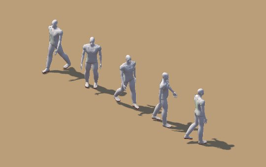

# Character prototype: stylized 3D humans (art direction B)

Status: **prototype for review**. It runs only in a test build made with `NEXT_PUBLIC_CHARACTER_LAB=1`, opened at
`/play?lab=characters`. Production builds never set that variable, so nothing changes for players.
Nothing here touches the database, migrations, the economy, or the multiplayer protocol.

Pictures are in `docs/character-prototype/`. Every claim below points at a picture or a measurement.

## 1. Audit: how characters are drawn today

| Part | Today |
| --- | --- |
| Art | `src/game/art/avatarArt.ts` paints each avatar choice (body × skin × headwear × outfit) with Canvas 2D at load time: no image files |
| Frames | 6 frames of 44×66 px (×2 texels): `idle0-1`, `walk0-3` |
| Directions | 1 (facing right); facing left is a horizontal flip |
| Animation | Phaser animations: walk 9 fps, idle 1.6 fps |
| Shadow | a separate ellipse under the feet |
| Entity | `src/game/entities/PlayerAvatar.ts`: `container`, `face(dx)`, `animate(dt, moving, dx)`, `destroy()` |
| Multiplayer | remote players use the same `PlayerAvatar`; the protocol sends position, `facing: 'left' \| 'right'` and `moving` |
| Choices | `AvatarSelection` = body (masc/femme), skin (4), headwear (5), outfit (6), checked by the server in `create_character` |

Limits for the requested look: one facing direction, four walk frames, and flat painted shapes. That is where the
gap with Lagos-Life-style characters comes from, not the environment.

## 2. Pre-rendered 3D sprites vs genuine real-time 3D

Both use the same 3D models. The question is whether the browser draws pictures of them or the models themselves.

| | Pre-rendered 3D sprites (recommended) | Genuine 3D in the browser |
| --- | --- | --- |
| Look | Offline path tracing: soft shadows, subsurface skin, strand hair. The best possible image quality per pixel | Real-time shading: hair has to become hair cards, skin is simpler; needs a 3D artist pass to look as good |
| Fits Phaser and the iso map | Yes: a character is a sprite, so it depth-sorts with buildings exactly like today | No: Phaser cannot draw skinned meshes. Needs a three.js layer, and characters behind buildings need depth compositing between two renderers, or the whole world moved to 3D |
| Phone cost | One textured quad per character | Skinning + shading of ~30k triangles per character every frame (measured in section 6) |
| Download | ~0.5 MB WebP per character (measured) | 1.29 MB GLB per character without hair (measured) + three.js r170 (167 kB gzipped, measured) |
| Directions and animation | Fixed: 8 directions, authored cycles. New animations need re-rendering | Free camera angles, blending, any number of animations |
| Customization | Each look must be rendered (combinatorial: see section 8) | Swap meshes and colours at run time |
| Risk | Low: the existing scene, depth sorting, collisions, multiplayer and UI stay | High: rendering architecture changes |

## 3. What was built

- `tools/character-pipeline/` builds the characters headlessly in Blender 5 (Python `bpy`):
  - `mhbody.py`: the body from MakeHuman's CC0 base mesh and shape targets (African ethnicity, sex, muscle,
    weight, height, proportions, face targets), rigged with MPFB2's CC0 "game engine" skeleton (53 bones) and skin weights.
  - `looks.py`: skin shader (subsurface scattering, pores, lip and brow masks), eyes (CC0 MakeHuman eye texture),
    strand hair (low fade, afro, cornrows with a braided bun), brows and beard, a fila, fabric shaders (denim,
    jersey, ankara wax print, adire tie-dye), the relaxed standing pose.
  - `garments.py`: clothes cut from MakeHuman's CC0 helper meshes (jersey, buba and sokoto, bodice and skirt,
    crop top, jeans, sneakers, sandals); body skin under clothes is masked so it cannot poke through.
  - `characters.py`: the four prototype characters.
  - `turnaround.py`: front, three-quarter, side and back views plus a head close-up.
  - `sprites.py`: the walk and idle cycles (authored here, not motion capture) and the 8-direction isometric
    sprite frames: orthographic camera at the game's 2:1 isometric angle, sun from the upper left like the world
    art, shadow-catcher ground (the contact shadow is in the sprite).
  - `atlas.py`: packs a character's 96 frames into one WebP atlas.
  - `export_glb.py`: the same character as a skinned GLB, for the real-time comparison.
- `src/game/characterLab/` and `src/game/scenes/StarterAreaScene.ts`: the in-game test.
  - `LabAvatar` has the same interface as `PlayerAvatar`. With the lab on, the scene creates **every** character
    through it: the local player and other players. So the style is identical for both.
  - Remote players face their actual movement direction on screen (worked out from their smoothed positions), so
    the protocol does not change. It still sends only left/right.
  - Four scripted walkers stroll around the spawn point. They go through the scene's remote-player code path and
    are never sent anywhere. `?lab=painted` shows the same walkers with today's painted characters, for comparison.
  - The existing avatar choices are kept. Each choice maps to the closest of the four prototypes (`labCharacterFor`).

### Licences

| Source | Used for | Licence |
| --- | --- | --- |
| MakeHuman 1.x system data (base mesh, targets, helpers, eye texture) | body, face shapes, garment base surfaces, eyes | CC0 |
| MPFB2 rig and weights (`rig.game_engine.json`, `weights.game_engine.json`) | skeleton and skinning | CC0 |
| Everything else (hair, clothes, shaders, poses, walk and idle cycles, lighting) | | written for this repo |

The MakeHuman walk BVH (AGPL) is **not** used. No other assets were downloaded.

## 4. Pictures

All are renders of the actual models, not concept art. Turnarounds and close-ups are Cycles renders at full
quality. The in-game shots are screenshots of the running game (headless Chromium).

### The four characters

| | Body | Skin | Hair | Outfit |
| --- | --- | --- | --- | --- |
| Tunde | man, athletic | deep brown | low fade | football jersey, jeans, sneakers |
| Femi | man, heavier, shorter | medium brown | low fade under a fila, short beard | adire buba and sokoto, sandals |
| Amaka | woman | very deep brown | cornrows into a braided bun, gold hoops | ankara bodice and skirt, sandals |
| Zainab | woman, tall | light brown | afro, gold hoops | crop top, high-waist jeans, sneakers |


### Front, three-quarter, side and back


### In the game (the existing Kuto Street, unchanged)

Five characters: your own (the closest prototype to your avatar choice) and the four walkers, which go through the
remote-player code path.

| Today (`?lab=painted`) | Prototype (`?lab=characters`) |
| --- | --- |
|  |  |
|  |  |

Phone size (390×844 at 2×):

| Today | Prototype |
| --- | --- |
|  |  |

### Same size, side by side

The game camera zoomed in 4× on the player in the running game. Both characters are drawn at exactly the same
world scale, with the same name tags, by the game itself:


## 5. Animation

Each character has 8 facing directions × (8 walk frames + 4 idle frames), packed in one atlas.

- **Walk.** A stride cycle every 0.5 s (16 fps). Hip swing and drop, counter-rotating shoulders, arms swinging
  against the legs, knee flex in the swing phase, heel strike and push-off, and a vertical bob.
- **Idle.** Breathing (chest and shoulders), a slow weight shift and a small head turn (2.5 fps).
- **Direction.** Picked from the actual movement on screen, so diagonal walking along the isometric streets
  faces the right way. The same rule serves the local player and other players.

Walking toward the viewer, diagonally, sideways and away, then idle:

| Tunde | Femi |
| --- | --- |
|  |  |
| **Amaka** | **Zainab** |
|  |  |

Every direction (top row: idle in all 8 directions; then the walk cycle in two directions):


## 6. Measurements

**All numbers are from a browser simulation, not a phone.** They come from headless Chromium with software
WebGL (SwiftShader) on a 4-core cloud container, at a desktop viewport (1366×768) and a phone-sized one (390×844 at
2× pixel density). Software WebGL makes frame rates far lower than any real GPU, so only the **relative**
differences mean anything. No real device was tested. Testing on a mid-range Android phone is a required next
step before rollout.

### Prototype vs today, in the same scene (5 characters)

Same build, same scene, same scripted walkers. The player walks for 5.6 s. The last of 4 runs is shown. Across
runs, fps varied by ±1, medians by ±0.3 ms and p95 by up to ±2 ms.

| | Desktop today | Desktop 3D sprites | Phone today | Phone 3D sprites |
| --- | --- | --- | --- | --- |
| Load to first world frame | 0.83 s | 1.17 s | 1.04 s | 1.27 s |
| Frame rate (software GL) | 15.1 fps | 15.5 fps | 33.0 fps | 31.1 fps |
| Main thread per frame, median / p95 | 2.8 / 4.3 ms | 2.7 / 4.2 ms | 2.5 / 3.9 ms | 2.4 / 4.2 ms |
| Texture memory (uncompressed RGBA) | 15.7 MB | 48.4 MB | 22.8 MB | 55.5 MB |
| Extra download | — | 1.9 MB (4 atlases) | — | 1.9 MB |
| Console errors | none | none | none | none |

Per character: atlas 1728×1280 WebP, **0.48–0.51 MB** to download, **8.4 MB** of GPU memory when decoded
(96 frames of 144×160 texels). Drawing cost per character is the same as today: one textured quad.

**Reading:** the frame cost does not change. The costs are texture memory (+8.4 MB per distinct character, the
item to manage on low-end phones: see section 8, step 3) and about 0.5 MB more download per character.

### Genuine real-time 3D, same model (three.js, skinned GLB)

The same Tunde model and walk, exported as a skinned GLB (`export_glb.py`): **1.29 MB, 31,450 triangles without
hair**. Strand hair cannot be exported, and the procedural materials export as plain colours, so this is the *cheap*
end of real-time 3D. It runs on an empty ground plane: no city, no UI. The sprite numbers above include the whole
Kuto Street scene.

| Characters | Desktop fps (shadows on / off) | Phone-size fps (on / off) | Triangles |
| --- | --- | --- | --- |
| 1 | 9.2 / 14.1 | 7.2 / 11.4 | 31k |
| 5 | 3.5 / 4.9 | 3.8 / 5.9 | 157k |
| 20 | 1.1 / — | 1.1 / — | 629k |



**Reading:** on the same simulated device, five real-time characters alone run 3–6× slower than the whole game
with five sprite characters. On a real GPU both are much faster, but the ratio points the same way: a skinned
30k-triangle character costs far more per frame than a sprite, and multiplayer scenes multiply it. Real-time 3D
would also need hair cards, real-time materials, LODs and a new rendering architecture before it looked as good
as the pre-rendered frames.

## 7. Honest assessment

What reached the target quality:

- **Bodies and proportions.** Realistic adult proportions and four distinct builds. Weight, muscle and height
  differ, so men and women do not share a silhouette.
- **Faces and skin.** African facial structure from MakeHuman's shape targets (nose width, lips, jaw).
  The skin uses subsurface scattering and four clearly different tones, from deep to light brown.
- **Hair.** Strand-rendered low fade, afro and cornrows with a bun read as real hair, not painted shapes. They also
  read at sprite size.
- **In the game.** Eight facing directions instead of one mirrored side, an 8-frame walk and a 4-frame idle,
  and lighting and contact shadows that match the painted world's sun. Local and remote players are drawn
  identically.

What did not, and why:

- **Clothes are the weak point.** They are cut from MakeHuman's skin-tight bodysuit and pushed outwards, so they hug
  the body. There is no real tailoring, collars, seams or folds. Femi's buba and sokoto read as pyjamas, the fila
  shape is crude, and the ankara skirt moves rigidly with the legs instead of swinging. Proper garment models
  would fix this: MakeHuman's CC0 clothes library (it could not be downloaded in this environment) or a 3D artist.
  The pipeline already fits MakeHuman garment files (`.mhclo`) to the body, so that is not a rebuild.
- **Animation is authored by hand in code**, so it is simpler than motion capture: no foot locking (slight foot
  slide), a modest arm swing and a subtle idle. A licensed or self-recorded CC0/CC-BY mocap walk would improve it.
- **At today's camera distance a character is about 55 px tall**, the same as the painted ones. So the face shows
  only a few pixels: the realism shows in silhouette, shading, hair and motion, not facial detail. Lagos Life frames
  its characters closer. If faces matter, the camera zoom or the character scale should go up (the atlases would
  then need a higher resolution).
- **Customization** is the real cost of this approach (section 8).

## 8. Recommendation and plan for a full implementation

**Recommendation: pre-rendered 3D sprites, using this pipeline.** It gives the best image per pixel, keeps Phaser,
the isometric depth sorting, collisions, multiplayer, chat, land and economy untouched, and costs a phone one
textured quad per character. Genuine real-time 3D would mean either a second renderer composited with Phaser
(characters behind buildings need shared depth) or moving the whole world to 3D. The measurements in section 6
show it is also far heavier on a phone-class device. That is a larger, riskier project for a smaller gain at this
camera distance.

Steps, each one reviewable on its own:

1. **Garments and hair assets** (the biggest quality lever). Use MakeHuman CC0 clothes, hair and shoes downloaded
   by the team, or commission a 3D artist for Nigerian outfits: agbada, buba and sokoto, iro and buba, gele, fila,
   ankara dresses, jerseys and jeans. The pipeline fits them to every body.
2. **Customization without combinatorial explosion.** The 2 bodies × 4 skins × 5 headwear × 6 outfits = 240 looks
   would be 240 atlases. Render **layers** instead: body (with a skin-tone mask tinted in the game), outfit and
   headwear/hair, each rendered with the other layers as holdouts so overlaps stay correct, and draw them stacked
   in Phaser. That is about 2 × (1 + 6 + 5) = 24 small atlases, and a character only loads its own 3 layers.
3. **Texture memory.** One RGBA atlas uses about 8.4 MB of GPU memory (1728×1280). For crowded scenes, use
   compressed GPU textures (KTX2/Basis: about 4–6× less), half-resolution atlases on low-memory phones, and only
   load the looks that are on screen.
4. **Animation set.** Walk, run, idle, sit, talk, phone, emotes, ideally from a licensed mocap library, all
   rendered by the same `sprites.py`.
5. **Optional protocol addition.** Send an 8-way facing so a standing remote player keeps their exact direction.
   Today it is derived from their movement, so standing players keep their last walking direction.
6. **Character creator** (the `/create` page) showing the rendered characters. Saving new appearance fields would
   need a database migration (`create_character` checks the options), which needs approval.

None of this needs a database change until step 6.

## 9. How to reproduce

Character pipeline (needs Python 3.13 with `bpy` 5.x from PyPI, and Pillow + numpy for packing):

```sh
git clone --depth 1 https://github.com/makehumancommunity/makehuman.git mh      # CC0 data in makehuman/data
git clone --depth 1 https://github.com/makehumancommunity/mpfb2.git            # CC0 rig in src/mpfb/data
export MH_DATA=$PWD/mh/makehuman/data MPFB_DATA=$PWD/mpfb2/src/mpfb/data OUT_DIR=$PWD/out
cd tools/character-pipeline
python turnaround.py -- tunde          # front / three-quarter / side / back / head renders
SAMPLES=16 python sprites.py -- tunde   # 96 isometric frames (~2.5-20 min per character on 4 CPU cores)
python3 atlas.py $OUT_DIR/tunde-frames tunde ../../public/prototype-characters
python export_glb.py -- tunde          # skinned GLB for the real-time comparison
```

The game test:

```sh
NEXT_PUBLIC_CHARACTER_LAB=1 npm run build && npm start
# then open /play?lab=characters (3D) or /play?lab=painted (today's art, same walkers), as a guest
```

Without `NEXT_PUBLIC_CHARACTER_LAB=1` the query is ignored: no atlas is downloaded, no walkers are added and no test hook is
exposed (checked: see the PR). The four atlases in `public/prototype-characters/` (1.9 MB) would still be deployed
as static files if this branch were merged as is, but nothing requests them. A real rollout would move them to
the asset pipeline chosen in section 8.
