# Character prototype: stylized 3D humans (art direction B)

Status: **prototype for review, iteration 2** (after the art-direction board). **Milestone 1** of the approved
pre-rendered sprite approach (consistent anchoring, layered body/outfit/hair, on-demand atlas loading, memory
selection) is reported in [`character-sprites-test-report.md`](character-sprites-test-report.md); its atlases have
replaced the iteration 2 ones in `public/prototype-characters/`. It runs only in a test build made with
`NEXT_PUBLIC_CHARACTER_LAB=1`, opened at `/play?lab=characters`. Production builds never set that variable, so nothing
changes for players. Nothing here touches the database, migrations, the economy, or the multiplayer protocol.

Pictures are in `docs/character-prototype/`. Every claim below points at a picture or a measurement.

## What changed in iteration 2

The board asked for believable Nigerian outfits instead of "generic 3D models wearing painted-on clothes".
Iteration 1 cut its clothes from a skin-tight bodysuit, so they hugged the body.

Iteration 2 builds **real garments**:

- **Shape.** Each garment is shaped from the body's cross-sections plus ease, so it hangs, bridges hollows and has its own silhouette.
- **Folds.** It is draped against the body (and against the garments under it) by a cloth simulation, which forms the folds.
- **Construction.** It is cut along clean hems and necklines and finished with collars, cuffs, waistbands, plackets and embroidery.
- **Shoes and accessories.** There are real soles, straps, a fila, a backpack, handbags, a watch, a necklace and hoops.

| Iteration 1 | Iteration 2 |
| --- | --- |
| 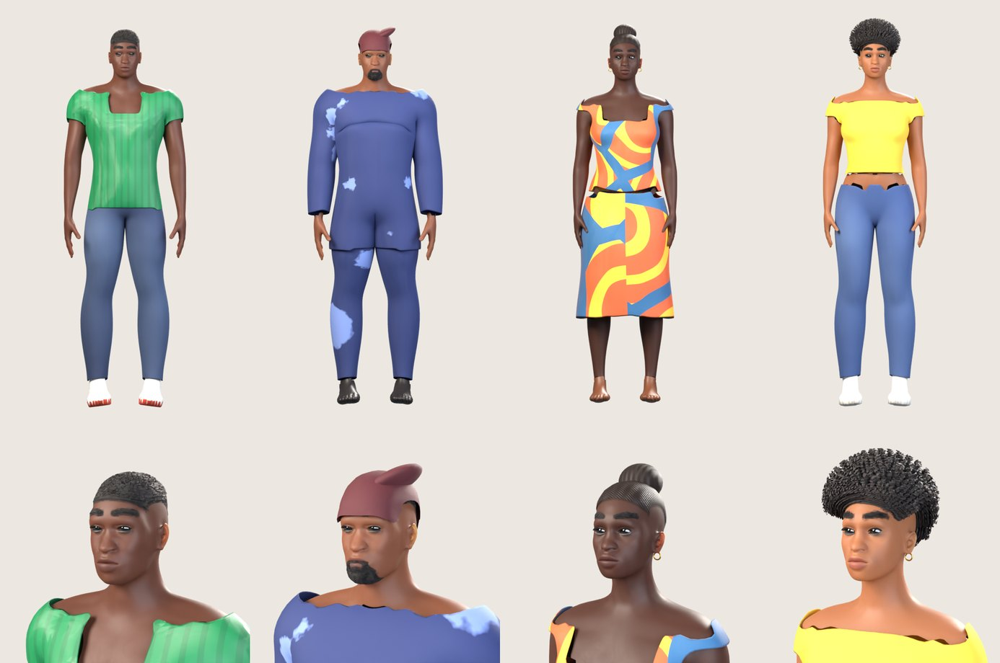 | 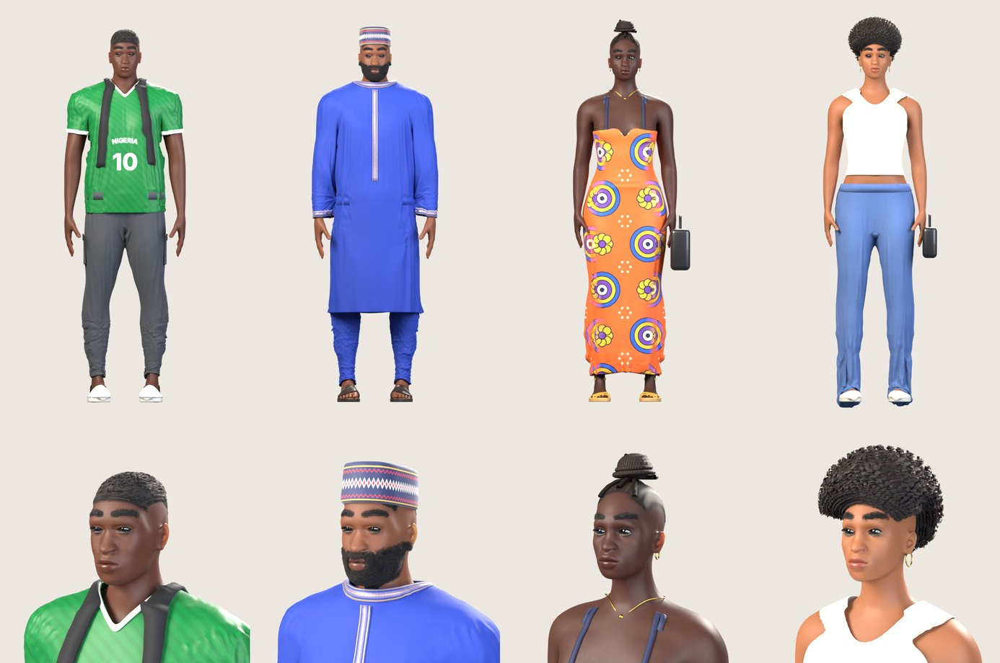 |

The outfits follow the board:

| | Body, skin | Hair | Outfit and accessories |
| --- | --- | --- | --- |
| Tunde | man, athletic, deep brown | low fade | green Nigeria jersey ("NIGERIA 10" front, "TUNDE 10" back, white V-neck rib and cuffs), dark cargo joggers with side pockets and ankle cuffs, white trainers with a green heel tab, backpack |
| Femi | man, heavier, medium brown | full short beard with moustache | royal-blue senator kaftan to below the knee with gold embroidery at the neckline, placket and cuffs, matching trousers, patterned fila, leather slides, gold watch |
| Amaka | woman, very deep brown | braids gathered into a coiled high bun | fitted ankara maxi dress (sweetheart neckline, straps, wax-print medallions and flowers), gold strappy sandals, black handbag, gold necklace and hoops |
| Zainab | woman, tall, light brown | big rounded afro | white crop tank, high-waist wide-leg jeans, white trainers, black handbag, large gold hoops |

## 1. Audit: how characters are drawn today

| Part | Today |
| --- | --- |
| Art | `src/game/art/avatarArt.ts` paints each avatar choice (body × skin × headwear × outfit) with Canvas 2D at load time: no image files |
| Frames | 6 frames of 44×66 px (×2 texels): `idle0-1`, `walk0-3` |
| Directions | 1 (facing right); facing left is a horizontal flip |
| Animation | Phaser animations: walk 9 fps, idle 1.6 fps |
| Shadow | a separate ellipse under the feet |
| Entity | `src/game/entities/PlayerAvatar.ts`: `container`, `face(dx)`, `animate(dt, moving, dx)`, `destroy()` |
| Multiplayer | remote players use the same `PlayerAvatar`; the protocol sends position, `facing: 'left' \| 'right'` and `moving` |
| Choices | `AvatarSelection` = body (masc/femme), skin (4), headwear (5), outfit (6), checked by the server in `create_character` |

## 2. Pre-rendered 3D sprites vs genuine real-time 3D

Both use the same 3D models. The question is whether the browser draws pictures of them or the models themselves.

| | Pre-rendered 3D sprites (recommended) | Genuine 3D in the browser |
| --- | --- | --- |
| Look | Offline path tracing: soft shadows, subsurface skin, strand hair, cloth simulation. The best image quality per pixel | Real-time shading: hair has to become hair cards, cloth folds must be baked, skin is simpler; needs a 3D artist pass to look as good |
| Fits Phaser and the iso map | Yes: a character is a sprite, so it depth-sorts with buildings exactly like today | No: Phaser cannot draw skinned meshes. Needs a three.js layer, with depth shared between two renderers, or the whole world moved to 3D |
| Phone cost | One textured quad per character | Skinning and shading of ~30k+ triangles per character every frame (measured in section 6) |
| Download | ~0.5 MB WebP per character (HD) or ~0.25 MB (SD), measured | 1.29 MB GLB per character without hair or clothes detail, plus three.js r170 (167 kB gzipped), measured in iteration 1 |
| Directions and animation | Fixed: 8 directions, authored cycles. New animations need re-rendering | Free camera angles, blending, any number of animations |
| Customization | Each look must be rendered (see section 8: layers) | Swap meshes and colours at run time |
| Risk | Low: the existing scene, depth sorting, collisions, multiplayer and UI stay | High: rendering architecture changes |

## 3. What was built

`tools/character-pipeline/` builds the characters headlessly in Blender 5 (Python `bpy`).

**Body and pose**
- `mhbody.py`: the body from MakeHuman's CC0 base mesh and shape targets (African ethnicity, sex, muscle, weight,
  height, proportions, face details), rigged with MPFB2's CC0 game-engine skeleton (53 bones) and skin weights.

**Garments (`tailor.py`)**

How a garment is made:
1. Its tubes (torso, sleeves, trouser legs, skirt) take the convex hull of the body's cross-section plus ease. Loose
   garments can hang from the chest and flare at the hem.
2. The tubes are fused into one surface by voxel remeshing.
3. Hems and necklines (round, V, scoop, sweetheart) and armholes are cut along smooth curves.
4. A short cloth simulation drapes the cloth against the body and the garments beneath it.
5. A clean-up pass pushes any cloth that ended up inside the body back out.
6. Bone weights are blended from the body. Skirts, dresses and kaftans swing with the hips instead of splitting
   between the legs.

The build pose:
- Garments are built with the arms raised, so sleeves never fuse with the torso.
- The arms are then lowered and the relaxed pose becomes the rest pose for everything.
- The cloth settles again in that pose, so the shoulders fall naturally.

Other garment parts:
- Ribbons make collars, cuffs, waistbands, plackets and straps.
- Unseen skin under the clothes is masked out, so it never pokes through while walking.

**Fabrics, outfits and accessories**
- `fabrics.py`: knit, twill and plain-weave cloth with sheen. Prints are drawn here as textures: the ankara wax print,
  the fila band, the gold embroidery and the jersey lettering. Everything is mapped from rest-pose coordinates, so
  prints stay on the moving cloth.
- `outfits.py`: the four outfits, in two stages. First the garments, then the details on the final pose.
- `kit.py`: footwear and accessories:
  - trainers (padded upper, cupsole, heel tab, lace panel) and sandals (sole and straps);
  - the fila, backpack, handbags, watch, necklace and earrings.

**Hair and faces**
- `hair.py`: the full beard and moustache, the braided bun, and the big afro (a soft volume plus fuzzy strands).
- `looks.py`: the skin shader (subsurface scattering, pores, glossier lips), eyes, the low fade, brows and the posing helpers.

**Rendering and packing**
- `characters.py`: the build order.
- `turnaround.py`: front, three-quarter, side and back views plus a head close-up.
- `sprites.py`: the walk and idle cycles (authored here, not motion capture). It renders the 8-direction isometric
  frames with an orthographic camera at the game's 2:1 angle, a sun matching the world art, and a shadow-catcher
  ground.
- `atlas.py`: grades each frame and fades its shadow before the frame edge. It then trims every frame to its visible
  pixels and packs them tightly into two atlases per character, HD (2 texels per pixel) and SD (1.25).

**In the game**
- `src/game/characterLab/` and `src/game/scenes/StarterAreaScene.ts`.
- `LabAvatar` has the same interface as `PlayerAvatar` and draws **every** character: the local player and other
  players. Facing comes from the actual movement on screen (8 directions), so the multiplayer protocol is unchanged.
- Atlases load as Phaser atlases with trimmed frames, so the anchor is unchanged.
- Devices reporting 4 GB of memory or less get the SD atlases. `?labq=hd|sd` overrides this for testing.
- Four scripted walkers stroll around the spawn point through the remote-player code path. They are never sent
  anywhere. `?lab=painted` shows the same walkers with today's characters.
- The existing avatar choices are kept and map to the closest prototype (`labCharacterFor`).

### Licences

| Source | Used for | Licence |
| --- | --- | --- |
| MakeHuman 1.x system data (base mesh, targets, eye texture) | body, face shapes, eyes | CC0 |
| MPFB2 rig and weights | skeleton and skinning | CC0 |
| System fonts (Inter / Liberation Sans) | jersey lettering, drawn into a texture | SIL OFL |
| Everything else (garments, prints, hair, shoes, accessories, shaders, poses, animation, lighting) | | written for this repo |

The MakeHuman walk BVH (AGPL) is not used. No art was downloaded. The art-direction board was used only as a
visual reference; nothing from it is copied into the game. The jersey uses plain lettering and colours, with no
federation crest and no sponsor or kit-maker logos.

## 4. Pictures

All are renders of the actual models. Turnarounds and close-ups are Cycles renders. The in-game shots are
screenshots of the running game (headless Chromium).

### Close-ups

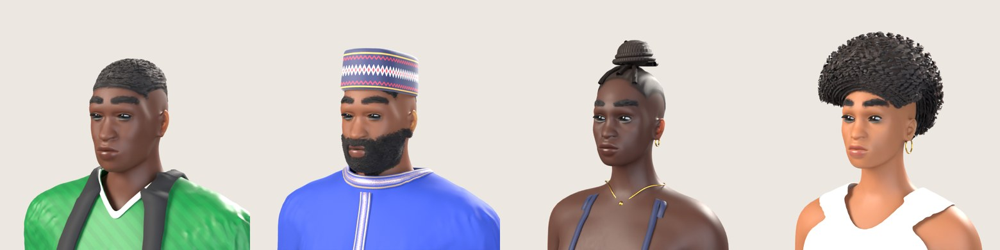

### Front, three-quarter, side and back

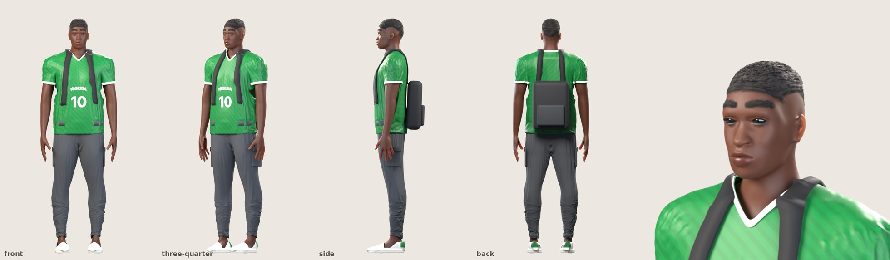
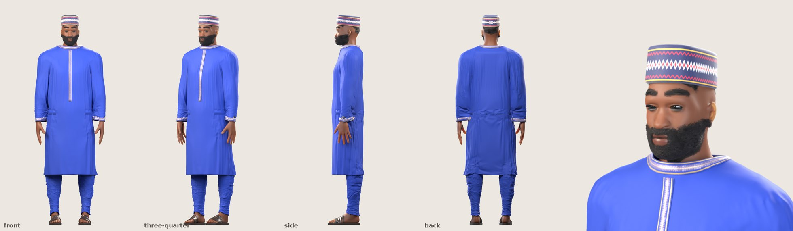
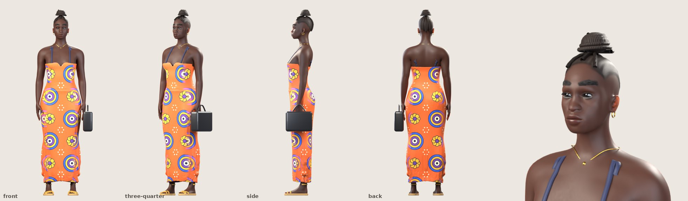
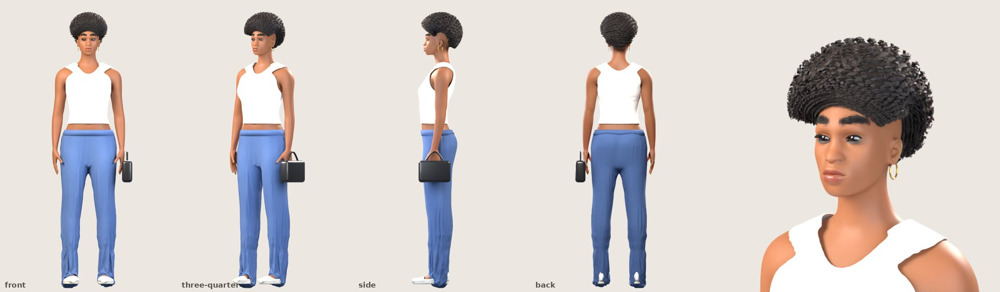

### In the game (the existing Kuto Street, unchanged)

Five characters: your own (the closest prototype to your avatar choice; here also Tunde) and the four walkers.

| Today (`?lab=painted`) | Prototype (`?lab=characters`) |
| --- | --- |
| 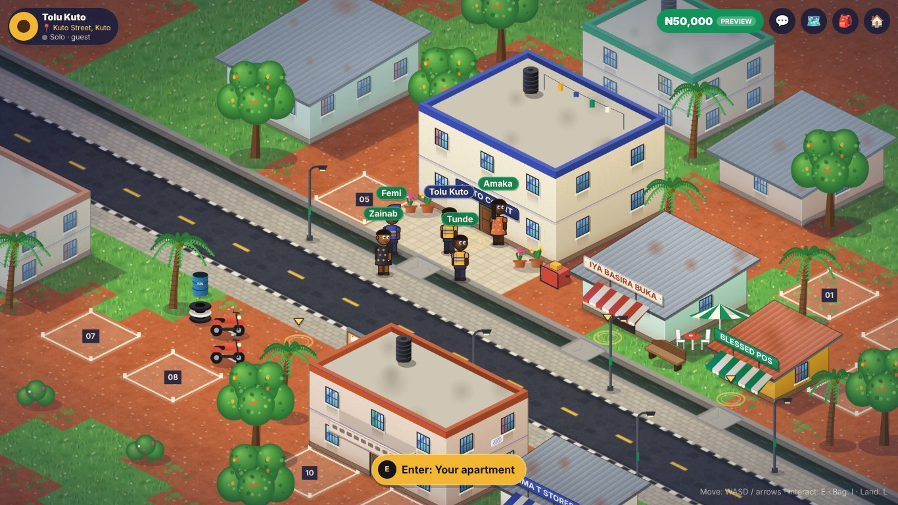 |  |
| 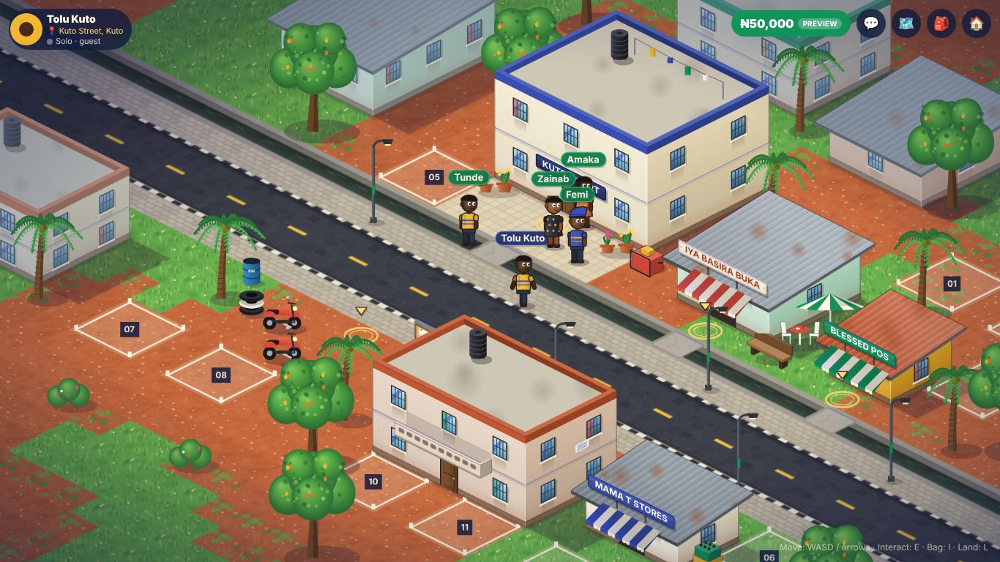 | 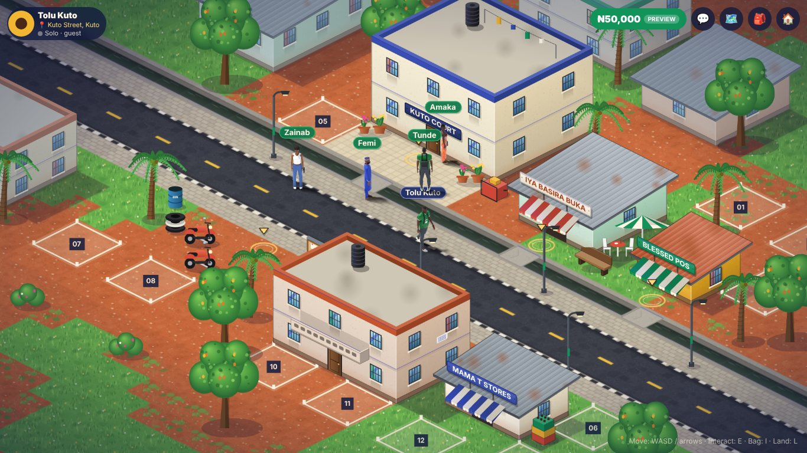 |

Phone size (390×844 at 2×):

| Today | Prototype |
| --- | --- |
| 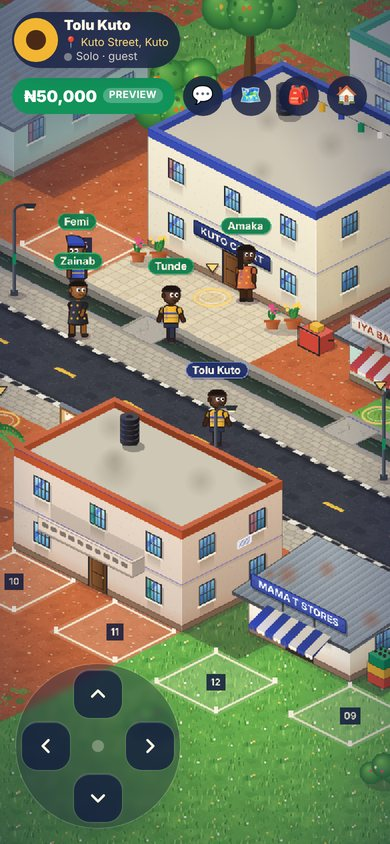 | 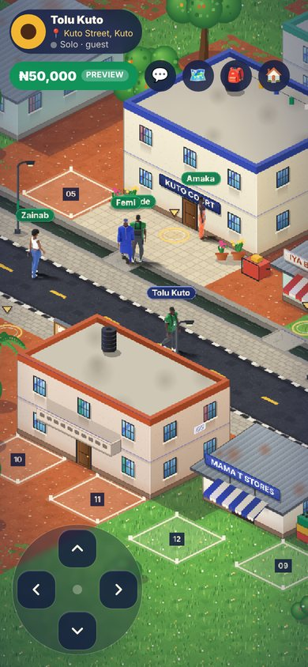 |

### Same size, side by side

The game camera zoomed in 4× on the player, rendered by the game itself at the same world scale:

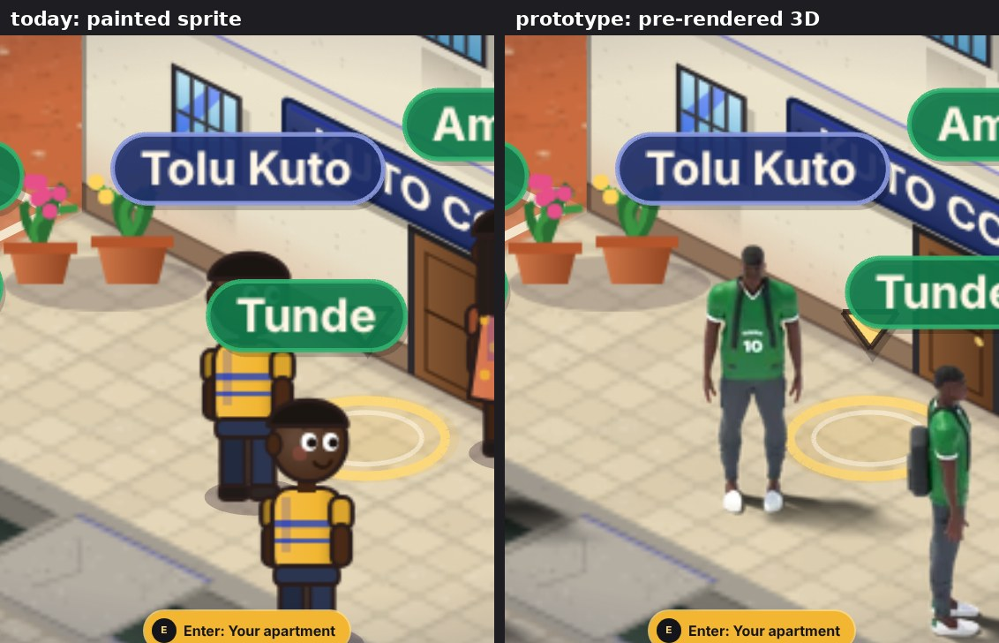
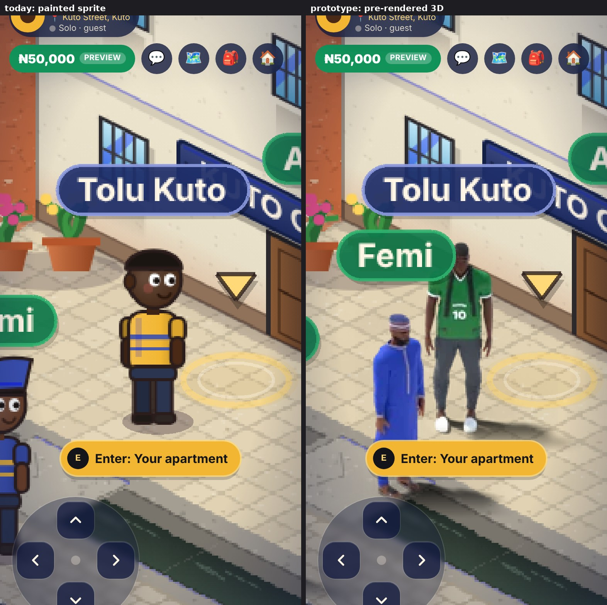

## 5. Animation

Each character has 8 facing directions × (8 walk frames + 4 idle frames).

- **Walk.** A stride every 0.5 s (16 fps). It has hip swing and drop, counter-rotating shoulders, arms swinging against
  the legs, knee flex in the swing phase, heel strike and push-off, and a vertical bob. The garments follow it: the
  kaftan and the maxi dress swing with the hips, sleeves and trouser legs follow the limbs.
- **Idle.** Breathing, a slow weight shift and a small head turn (2.5 fps).
- **Direction.** Picked from the actual movement on screen. The same rule serves the local player and other players.

Walking toward the viewer, diagonally, sideways and away, then idle:

| Tunde | Femi |
| --- | --- |
| 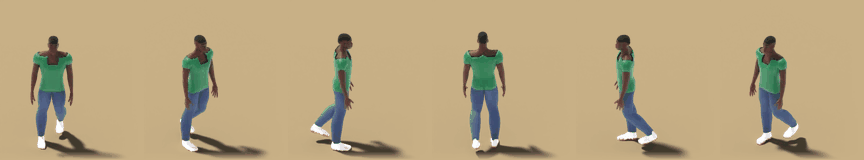 | 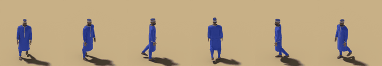 |
| **Amaka** | **Zainab** |
| 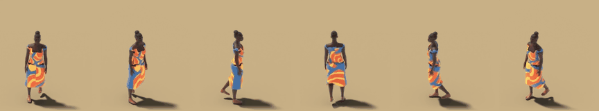 | 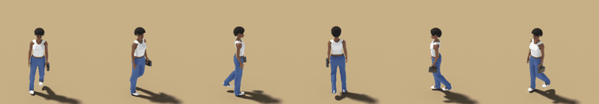 |

Every direction (top row: idle in all 8 directions; then the walk in two directions):

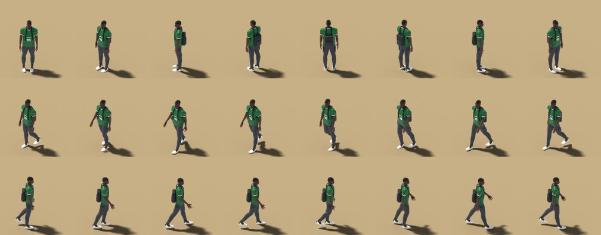
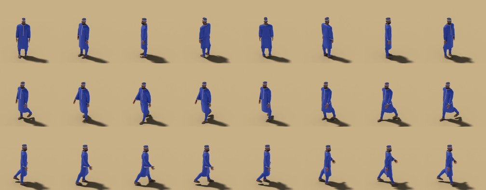
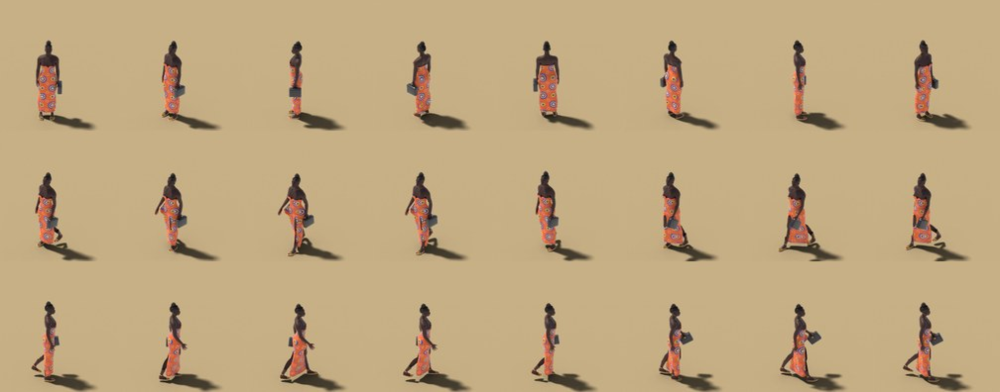
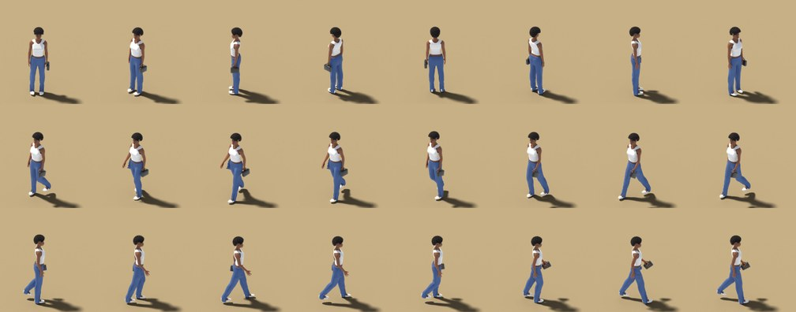

## 6. Measurements

**All numbers are from a browser simulation, not a phone.** They come from headless Chromium with software WebGL
(SwiftShader) on a 4-core cloud container. The viewports were desktop (1366×768) and phone-sized (390×844 at 2×).
Software WebGL makes frame rates far lower than any real GPU, so only the **relative** differences mean anything.
**No real device was tested.** Testing on a mid-range and a low-end Android phone is a required next step before
rollout.

### Atlases (Android memory)

| Per character | Iteration 1 | Iteration 2 HD | Iteration 2 SD |
| --- | --- | --- | --- |
| Atlas size | 1728×1280 | about 2000×750–940 | about 2000×320–430 |
| GPU memory (RGBA) | 8.4 MB | 5.6–7.3 MB | 2.4–3.3 MB |
| Download (WebP) | 0.48–0.51 MB | 0.46–0.52 MB | 0.22–0.26 MB |

The frames are bigger than in iteration 1 (84×88 world px: room for loose garments, bags and the afro), yet HD
uses less memory. Each frame is trimmed to its visible pixels and packed tightly, and Phaser keeps the anchor from
each frame's original size. SD uses about 60% less memory than HD.

### Prototype vs today, in the same scene (5 characters)

Same build, same scene, same scripted walkers. The player walks for 5.6 s.

| | Desktop today | Desktop 3D HD | Desktop 3D SD | Phone today | Phone 3D HD | Phone 3D SD |
| --- | --- | --- | --- | --- | --- | --- |
| Load to first world frame | 0.87 s | 1.26 s | 0.93 s | 1.22 s | 1.15 s | 1.31 s |
| Frame rate (software GL) | 14.3 fps | 15.5 fps | 15.2 fps | 33.2 fps | 33.5 fps | 32.5 fps |
| Main thread per frame, median / p95 | 3.2 / 4.3 ms | 2.6 / 4.3 ms | 2.8 / 3.9 ms | 2.3 / 3.7 ms | 2.3 / 3.8 ms | 2.4 / 3.7 ms |
| Texture memory, whole game (RGBA) | 15.7 MB | 41.7 MB | 26.3 MB | 22.8 MB | 48.9 MB | 33.4 MB |
| ...of which the 4 character atlases | — | 27.1 MB | 11.7 MB | — | 27.1 MB | 11.7 MB |
| Extra download | — | 2.0 MB | 1.0 MB | — | 2.0 MB | 1.0 MB |
| Console errors | none | none | none | none | none | none |

**Reading:**
- The frame cost does not change: drawing a character is one textured quad, however detailed the render.
- Load times vary by about ±0.3 s between runs in this environment.
- The cost to manage is texture memory. HD adds about 6–7 MB per distinct character on screen, SD about 3 MB.

### Genuine real-time 3D (measured in iteration 1)

The iteration-1 Tunde was exported as a skinned GLB: 31,450 triangles without hair. Five of them on an empty
plane ran at 3.5–4.9 fps (desktop) and 3.8–5.9 fps (phone-size) in the same simulated browser. That compares with
about 15 and 33 fps for the whole game with five sprite characters. The iteration-2 garments add geometry
(remeshed cloth, ribbons, soles): iteration-2 Amaka exported the same way is **4.7 MB and 117,972 triangles without
hair**, about 4× iteration 1. Real-time versions would need a dedicated low-poly version of every garment.

## 7. Honest assessment against the board

Close to the board:
- **Recognisable, distinct characters.** Each one reads at a glance, even at game size: the kaftan and fila, the
  ankara maxi dress, the white tank and jeans with the afro, the green jersey with the backpack.
- **Clothing has real shape.** Garments hang, flare, overlap (jersey over joggers, kaftan over trousers) and have
  collars, cuffs, waistbands, hems, plackets, embroidery and soles. They are no longer painted on.
- **Native wear.** The senator outfit and fila, and the ankara print.
- **Hair.** The fade, beard, braided bun and big afro.
- **Accessories.**
- **In-world consistency.** One scale, one sun direction, contact shadows, correct depth sorting, and 8 directions
  for local and remote players alike.

Still short of the board (the board is concept art; this is what the pipeline produces today):
- **Fabric detail is simplified.**
  - Folds come from a short simulation, so they are softer and fewer than in the concept art.
  - Jeans read as smooth denim without seams or pockets.
  - The jersey has no sponsor details by design.
  - Femi's trousers and Zainab's jeans show some crumpling at the ankle.
- **Faces are good but generic.** The bodies come from MakeHuman's average heads with African shape targets. The
  board's faces are more individual and more stylised. A sculpting pass per character (or more face targets) would close that.
- **The braided bun is simplified.** Braids are tubes over a dark cornrow base, without individual box-braid texture.
- **Animation is authored in code.** There is no foot locking and only a modest arm swing. Long skirts swing as
  a whole rather than folding around the legs.
- **Faces at game size.** At today's camera distance a character is about 55 px tall, the same as the painted ones.
  What shows is silhouette, colour, outfit and hair, not facial detail. If faces matter in play, the camera needs to
  come closer or the character scale needs to grow (with higher-resolution atlases).

## 8. Recommendation and plan for a full implementation

**Recommendation: pre-rendered 3D sprites, using this pipeline.** Iteration 2 shows it can produce believable
Nigerian clothing, footwear and accessories. It costs a phone nothing per frame beyond a textured quad and keeps
Phaser, depth sorting, collisions, multiplayer, chat, land and economy untouched.

Steps, each reviewable on its own:

1. **Wardrobe.** Add the remaining board outfits as garment recipes in `outfits.py`: agbada, iro and buba with a gele,
   and more casual and street sets. Optionally commission a 3D artist for hero pieces (sculpted folds, seams). The
   pipeline fits any garment to every body.
2. **Customization without combinatorial explosion.** Render layers instead of full characters:
   - the body, with a skin-tone mask tinted in the game;
   - each outfit;
   - each hairstyle or headwear.

   Each layer is rendered with the others as holdouts, so overlaps stay correct, and the layers are stacked in
   Phaser. That makes about 2 × (1 + 6 + 5) = 24 small atlases instead of 240 full ones.
3. **Memory.**
   - Keep trimmed atlases and SD for low-memory phones (done here).
   - Add compressed GPU textures (KTX2/Basis, roughly 4–6× less).
   - Load only the looks that are on screen.
4. **Animation set.** Run, sit, talk, phone, emotes and turning, ideally from licensed motion capture, all rendered by
   the same `sprites.py`.
5. **Optional protocol addition.** Send an 8-way facing, so a standing remote player keeps their exact direction.
6. **Character creator.** Show the rendered characters on `/create`. Saving new appearance fields would need a
   database migration, which needs approval.
7. **Real-device testing** on mid-range and low-end Android phones (frame time, memory, load).

None of this needs a database change until step 6.

## 9. How to reproduce

Character pipeline: set up with `bash tools/character-pipeline/setup.sh` (pinned packages and pinned CC0 asset
commits; see `tools/character-pipeline/README.md`), then:

```sh
source ~/.cache/ogs-character-pipeline/env.sh
cd tools/character-pipeline
$PY turnaround.py -- femi            # front / three-quarter / side / back / head (RS=0.7 VIEWS=front,three for a preview)
SAMPLES=16 $PY sprites.py -- femi    # 96 isometric frames (about 4-19 min per character on 4 CPU cores)
$PY atlas.py $OUT_DIR/femi-frames femi ../../public/prototype-characters   # femi-hd/sd .webp + .json
```

Building one character takes 1–3 minutes (garment simulation included). Milestone 1 adds layered renders
(`LAYERS=body,outfit,hair`) and `check_anchors.py`; see the test report. The nine atlases plus JSON in
`public/prototype-characters/` total about 4.9 MB.

The game test:

```sh
NEXT_PUBLIC_CHARACTER_LAB=1 npm run build && npm start
# then open /play?lab=characters (3D), /play?lab=characters&labq=sd (low-memory atlases)
# or /play?lab=painted (today's art, same walkers), as a guest
```

Without `NEXT_PUBLIC_CHARACTER_LAB=1` the query is ignored. No atlas is downloaded, no walkers are added and no
test hook is exposed (checked: see the PR). The atlases in `public/` would still be deployed as static files if
this branch were merged as is, but nothing requests them.
