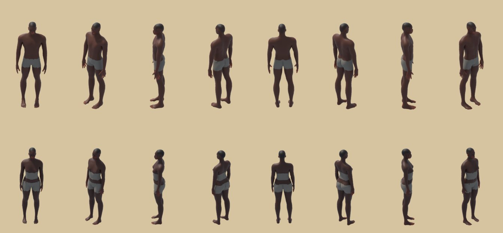
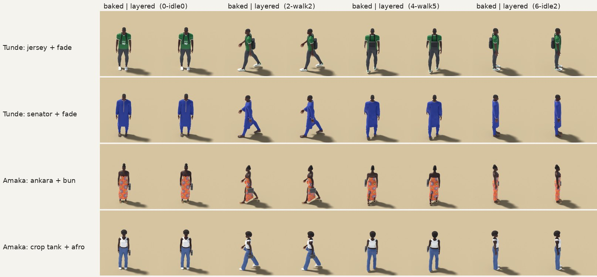
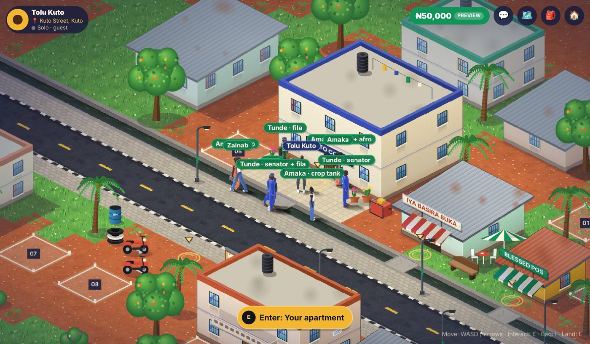
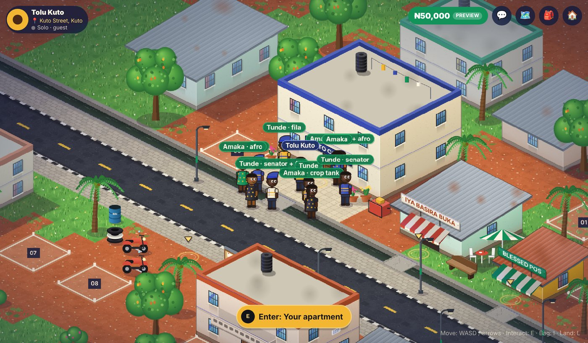
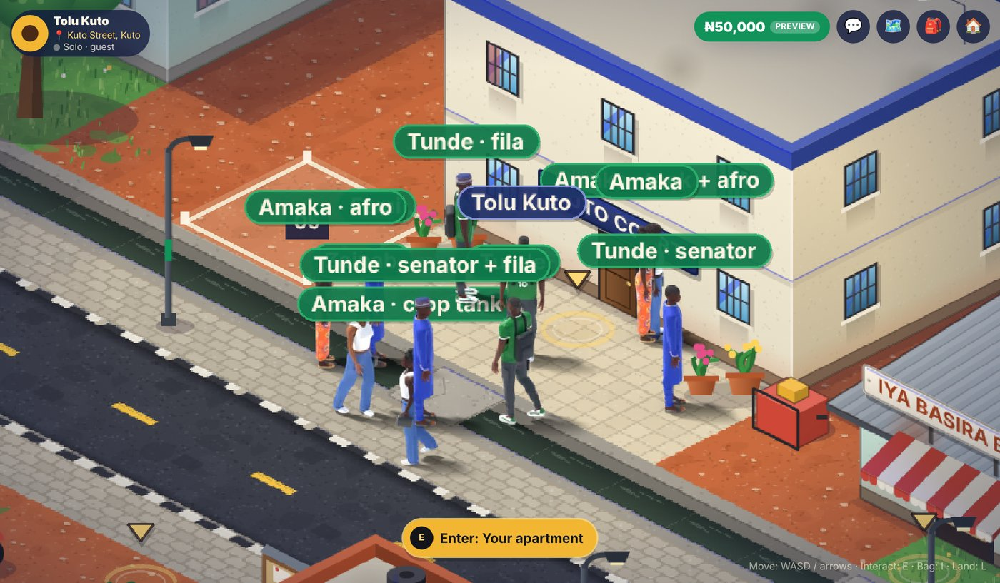
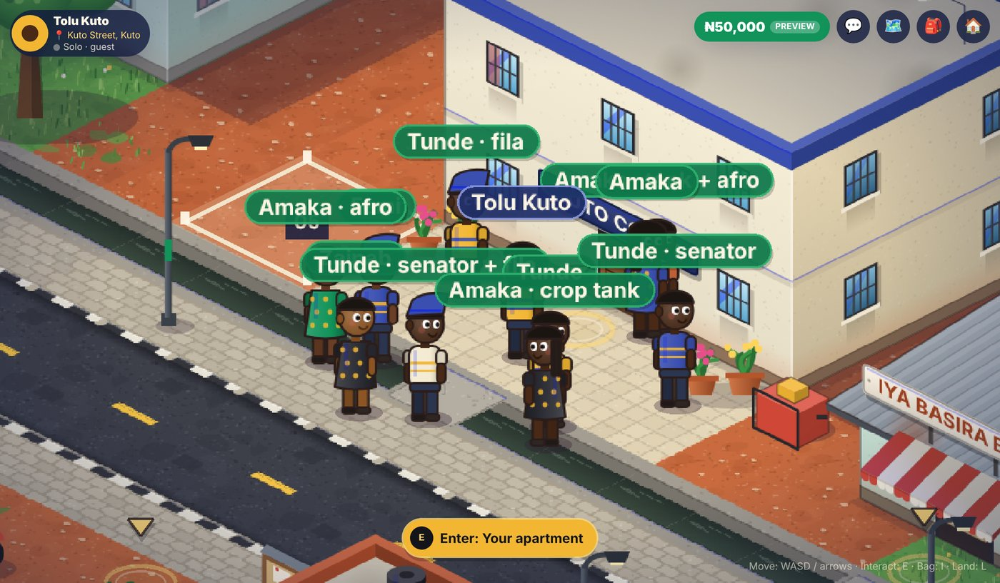
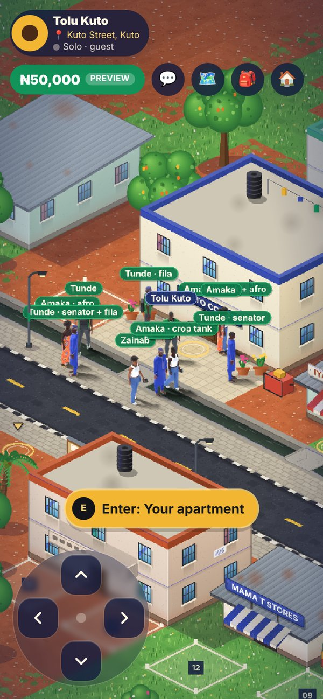
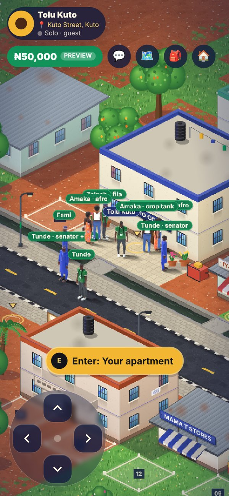
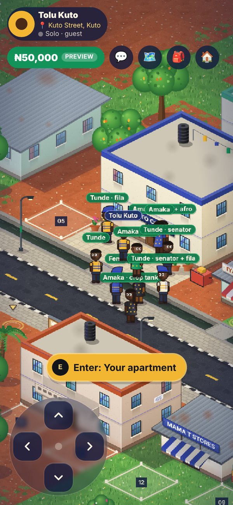
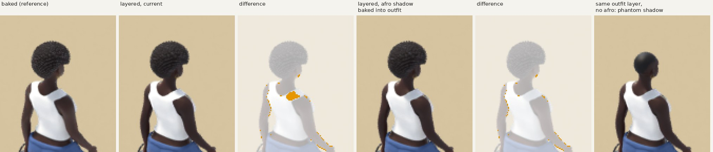

# Pre-rendered 3D character sprites: milestone 1 test report

Status: **visual prototype for review**. Nothing is merged, deployed or changed in the database.
It runs only in a lab build (`NEXT_PUBLIC_CHARACTER_LAB=1`) at `/play?lab=characters`.
Pictures are in `docs/character-prototype/m1/`.

> **About the measurements.** Every in-game number below comes from **headless Chromium with software WebGL
> (SwiftShader) on a 4-core cloud container**. Some runs emulate a phone: a 390×844 viewport at DPR 2 with touch,
> plus a faked `navigator.deviceMemory`. That is a **browser simulation**. **No real Android device was tested.**
> The absolute frame rates mostly reflect software rendering. The useful comparisons are within a column (painted
> vs 3D, HD vs low-memory) under the same conditions.

## Summary

| Requirement | Result |
| --- | --- |
| 1. Quality | All four characters keep their modelled garments, with improvements at game distance: trainers with a heel tab, side stripe, laces and sole line; stitched denim with pockets; knee seams on the cargos; corrected hems; finer brows; a glossier lip; a rim light so dark skin and dark clothes separate from the ground; a cleaner bun and a cropped tank. Fabric folds and seams are clear in close renders. At in-game size the silhouette, colours, prints and footwear read; heads are only about 8 px tall at 1× zoom, so facial detail is only legible at 2× (phone) or when zoomed in. |
| 2. Sprite pipeline | 8 directions × (8 walk + 4 idle) frames per character, with the same lighting, scale and camera. Transparent backgrounds with a contact shadow. **Feet anchoring measured: 0.000 px pivot error in every direction for every atlas, 0.00 px scale spread, at most 1.14 px pelvis shift when turning** (limit 3 px). Phaser rendering and depth sorting are unchanged. |
| 3. Mobile | HD (2 texels/px) and low-memory SD (1.25 texels/px) atlases. Selection is automatic: SD when `deviceMemory ≤ 4`, overridable with `?labq=hd\|sd`. Loading is on demand: the local player's atlas loads first and other characters' atlases only when someone wearing them appears. Measured with 5 and 21 characters (simulated, see the note above). |
| 4. Customisation | **Layered sprites** stack body, outfit and hair, all from the same skeleton and cameras. One body atlas plus outfit and hair atlases make any combination without a new full atlas. Demonstrated: one body × 2 outfits × 2 hairstyles = 4 looks from 5 atlases. Stacked layers match the baked render to 0.43/255. All existing avatar options are kept. |
| 5. Multiplayer | Local and remote players use the same `LabAvatar` renderer. Identity, movement messages, collisions and gameplay code paths are unchanged. Remote avatars face their own movement direction. |
| 6. Screenshots | Below. |
| 7. Safety | Feature branch `feat/character-3d-prototype` (PR #19, draft) only. No merge, deploy, database or migration changes. The flag-off build was checked: 0 atlas requests, no test hook, no page errors. |

## 1. Characters

Full body and close-up (Cycles renders of the models that the sprites come from):


Front, three-quarter, side and back:


| | Skin, body | Hair | Outfit |
| --- | --- | --- | --- |
| Tunde | deep brown, athletic | low fade | Nigeria 10 jersey, cargo joggers with side pockets and knee seams, white/green trainers, backpack |
| Femi | medium brown, heavier | short beard; patterned fila | royal-blue senator kaftan with embroidery, sokoto, leather slides, watch |
| Amaka | very deep brown | braids in a coiled high bun | ankara maxi dress, gold sandals, handbag, necklace, hoops |
| Zainab | light brown, tall | big afro | white crop tank, wide-leg stitched jeans, white trainers, handbag, hoops |

## 2. Walk and idle in 8 directions

Each sheet has one row per direction (S, SW, W, NW, N, NE, E, SE). Walk frames 0–7 sit left of the grey line and
idle frames 0–3 to the right. They are drawn **from the packed HD atlas** exactly as the game reconstructs them, at 3×. The red
line is the anchor row and the red tick is the anchor pixel: the feet land on it in every direction.


Animated, all 8 directions side by side: [Tunde](character-prototype/m1/walk8-tunde.gif) ·
[Femi](character-prototype/m1/walk8-femi.gif) · [Amaka](character-prototype/m1/walk8-amaka.gif) ·
[Zainab](character-prototype/m1/walk8-zainab.gif)

### Direction changes without jumps (measured)

`sprites.py` now orbits the camera around the **point between the feet** in the rest pose, instead of the world
origin. Iteration 2 was 5.5 cm off, which moved the character up to 1.8 px from its anchor and 3.7 px between opposite
directions. While rendering it records where the pivot, pelvis and top of the head land in every frame.
`check_anchors.py` checks those positions:

| Atlas | Pivot error | Scale spread (head height, opposite pairs) | Largest pelvis shift on a turn | Result |
| --- | --- | --- | --- | --- |
| tunde | 0.000 px | 0.00 px | 1.14 px | OK |
| femi | 0.000 px | 0.00 px | 1.08 px | OK |
| amaka | 0.000 px | 0.00 px | 1.04 px | OK |
| zainab | 0.000 px | 0.00 px | 1.12 px | OK |
| body-tunde, outfit-tunde.tunde, outfit-femi.tunde | 0.000 px | 0.00 px | 1.14 px | OK |

The remaining ≈1 px pelvis shift is the body genuinely rotating 45° around the feet, not drift. Limits are 0.05 px, 1 px
and 3 px. The atlas packer trims each frame but keeps `spriteSourceSize`/`sourceSize`, so trimming never moves a frame.

## 3. In the game: Kuto Street

The existing map, buildings and Phaser depth sorting are unchanged. Characters pass behind and in front of
buildings, posts and each other as before.

The four characters and the three layered looks walking together (desktop, 1200×700 at DPR 2, camera 2×):


The same at normal zoom, mid-walk (1366×768):


Phone viewport (390×844, DPR 2, normal zoom), HD vs low-memory:

| HD | Low-memory (SD) |
| --- | --- |
|  |  |

Stress test, 21 characters on a simulated 2 GB phone (SD atlases selected automatically):


## 4. Before / after at the same in-game size

Rows 1–2 are iteration 2 and rows 3–4 are milestone 1. Each is shown at 1 device px per world px (desktop) and 2 device px per world px (phone,
DPR 2), on the street's ground colour and scaled up with nearest-neighbour so the pixels are visible:


What changed at this size:

- **Trainers.** They have a green heel tab and side stripe, so Tunde's trainers read as designed shoes.
- **Lighting and separation.** The rim light separates the dark jersey, cargo and skin from the shadow.
- **Hems.** Femi's sokoto hem sits at the ankle.
- **Jeans.** Zainab's wide-leg jeans now break on the shoe and show their seams.
- **Hair.** Amaka's bun reads as a bun.
- **Painted baseline.** Today's look, at the same camera, is in [`kuto-group-painted.jpg`](character-prototype/m1/kuto-group-painted.jpg).

## 5. HD vs low-memory

Each frame is drawn at 2 device px per world px (a DPR 2 phone at normal zoom) with bilinear filtering, as WebGL does, then
magnified 3× for inspection:


The low-memory atlas is softer, especially on the jersey lettering, the embroidery and the ankara print. Silhouette,
colours, outfit identity and footwear stay clear. In the phone screenshot above at true size the difference is hard
to see. **Assessment: acceptable for low-memory phones** (to be confirmed on a real device).

## 6. Customisation: layered body, outfit and hair

`sprites.py` can render the same character as separate layers:

- **body:** skin and face, with the clothes as a holdout;
- **outfit:** garments, shoes and accessories, with the body as a holdout;
- **hair:** hair and headwear, with body and clothes as holdouts.

All layers share the skeleton, cameras and anchors, so the game stacks them (body → outfit → hair) on the same
frame. **Stacking body + jersey + fade reproduces the baked Tunde render: mean difference 0.43/255 over 96 frames,
1.25% of pixels differ by more than 16/255, all at anti-aliased edges.**


Row 1 is baked. Rows 2–5 are stacked layers: jersey or senator outfit, fade or fila. The senator outfit and the fila are
Femi's garment designs, re-fitted and draped on Tunde's body (`sprites.py -- tunde femi fade`).

Atlases this needs:

| Way to get 4 looks for one body | Atlases | HD download | HD GPU memory |
| --- | --- | --- | --- |
| baked, one full atlas per combination | 4 | ≈ 4 × 490 KB | ≈ 4 × 7 MB |
| layered: 1 body + 2 outfits + 2 hair | 5 | 1.25 MB | 16.3 MB |

The atlases needed grow with the **sum** of options, not the **product**. Outfits are fitted per body shape, so for B body
shapes, O outfits and H hairstyles the count is about B × (1 + O + H) atlases, not B × O × H. A player only downloads
the layers they see.

The cost of layering:

- **Draws.** A layered character draws 3 sprites instead of 1. These are the same texture-atlas draws that Phaser batches.
- **Memory.** One layered look alone uses about 30% more memory than its baked atlas (9.5 MB vs 7.3 MB HD), because
  layers overlap. Sharing pays back once a body is used with two or more looks.

**Correction (2026-10-25).** An earlier version of this report said the body layer is masked under the outfit it
was rendered with. That is wrong. The milestone-1 code renders the body layer as **the whole, unmasked skin**: in
`sprites.py`, the body pass turns the `Covered` mask off. The mask is kept only on the hidden holdout copy used to
cut the outfit and hair passes, and that copy matches each outfit.

So an outfit that shows more skin cannot open holes in the body layer. What the body layer still lacks is neutral
base clothing: under an outfit's gaps it is a nude body. Adding that base, and an automated layered-vs-baked gap check
over more outfit combinations, is the next character task. The existing painted avatar options, the avatar
picker and the save format are unchanged.

## 7. Atlases

WebP, quality 88 (alpha 90), frames trimmed and shelf-packed into ≤ 2048 px wide sheets:

| Atlas | HD size | HD file | HD GPU | SD size | SD file | SD GPU |
| --- | --- | --- | --- | --- | --- | --- |
| tunde | 2041×939 | 508 KB | 7.3 MB | 2033×343 | 249 KB | 2.7 MB |
| femi | 2048×784 | 452 KB | 6.1 MB | 2041×333 | 223 KB | 2.6 MB |
| amaka | 2039×620 | 435 KB | 4.8 MB | 2021×239 | 208 KB | 1.8 MB |
| zainab | 1984×796 | 478 KB | 6.0 MB | 2022×340 | 239 KB | 2.6 MB |
| body-tunde | 2011×363 | 285 KB | 2.8 MB | 2048×156 | 160 KB | 1.2 MB |
| outfit-tunde.tunde | 2039×849 | 475 KB | 6.6 MB | 2032×310 | 228 KB | 2.4 MB |
| outfit-femi.tunde | 2034×848 | 439 KB | 6.6 MB | 2030×309 | 211 KB | 2.4 MB |
| hair-fade.tunde | 1765×18 | 20 KB | 0.1 MB | 1345×13 | 13 KB | 0.1 MB |
| hair-fila.tunde | 1916×22 | 29 KB | 0.2 MB | 1512×15 | 19 KB | 0.1 MB |

The four baked characters total 24.3 MB of GPU memory in HD (iteration 2: 27.1 MB) and 9.7 MB in SD (iteration 2: 11.7 MB).

I tested lower WebP quality on Tunde: q82 saves 7% (510 → 476 KB HD) at a mean change of 2.8/255 on character
pixels; q76 saves 12% at 3.5/255. GPU memory does not change with file quality, so I kept q88. Per-atlas
quality can be lowered later if download size matters more than print detail.

## 8. Measurements in the game (browser simulation, not a phone)

The harness opens `/play` as a guest in a lab build:

1. It waits for the world, then for every character to be drawn from its atlases.
2. It measures frame rate and main-thread time per frame for 5.6 s while the player walks a square.
3. It counts texture memory and records every atlas download.

| Run | `deviceMemory` | Atlases picked | Characters | World ready | All characters drawn | FPS* | Main thread / frame (median, p95) | Texture memory (all / characters) | Atlas download |
| --- | --- | --- | --- | --- | --- | --- | --- | --- | --- |
| desktop, painted (today) | – | – | 5 | 1151 ms | 1673 ms | 12.9 | 3.2 / 5.1 ms | 15.7 / 0 MB | 0 |
| desktop, 3D | 8 | HD | 5 | 956 ms | 1938 ms | 13.9 | 2.8 / 4.5 ms | 38.9 / 24.3 MB | 1876 KB |
| desktop, 3D, `labq=sd` | 8 | SD (forced) | 5 | 1011 ms | 1902 ms | 13.7 | 3.2 / 4.5 ms | 24.3 / 9.7 MB | 921 KB |
| desktop, 3D + layered looks | 8 | HD | 8 | 990 ms | 2741 ms | 11.8 | 4.5 / 6.4 ms | 55.1 / 40.5 MB | 3126 KB |
| phone, painted (today) | – | – | 5 | 1246 ms | 1572 ms | 27 | 3.1 / 4.6 ms | 22.8 / 0 MB | 0 |
| phone, 3D | 8 | **HD** | 5 | 1208 ms | 1970 ms | 28 | 3.1 / 5.0 ms | 46.1 / 24.3 MB | 1876 KB |
| phone, 3D | 2 | **SD** | 5 | 1214 ms | 2022 ms | 30 | 2.9 / 4.2 ms | 31.5 / 9.7 MB | 921 KB |
| phone, 21 painted (today) | – | – | 21 | 1094 ms | 1549 ms | 18.2 | 8.9 / 13.1 ms | 22.8 / 0 MB | 0 |
| phone, 21 3D + layered | 2 | **SD** | 21 | 1061 ms | 2069 ms | 19.5 | 8.2 / 10.8 ms | 37.7 / 15.9 MB | 1555 KB |
| phone, 21 3D + layered | 8 | **HD** | 21 | 1131 ms | 2490 ms | 19.4 | 8.5 / 12.0 ms | 62.3 / 40.5 MB | 3126 KB |

\* Software WebGL on CPU, so not comparable to a phone GPU. In every pair, painted and 3D run at the same rate.

What this shows:

- **Memory selection works.** `deviceMemory` 8 picks HD and 2 picks SD, and `?labq` overrides it. Every run downloaded only one
  quality, and no run reported page errors.
- **Loading is on demand and does not block the world.** The world is ready in about 1 s with or without 3D characters.
  The local player's atlas is requested first, at about 1.5 s. Other characters' atlases follow when their walkers appear, and atlases
  shared by several looks (`body-tunde`, `hair-fade.tunde`) download once. Until its atlas arrives, a character shows a
  placeholder shadow and name tag, and then switches over.
- **Frame cost is unchanged.** Main-thread time per frame is the same as the painted characters with 5 and with 21
  characters. Sprites are textured quads either way.
- **Memory** is the real cost: +24 MB (HD) or +10 MB (SD) for the four baked characters, and +40 MB / +16 MB with all nine
  atlases. This is why SD exists and why layers load on demand.

### Not tested

- **Real Android devices.** Real phones may differ in GPU upload time for large textures, thermal throttling, WebView
  memory limits and real network latency. These are the next things to measure (section 9).
- **Slow networks.** Downloads were from localhost. On 3G, about 1–2 MB of HD atlases is several seconds. The world does not wait
  for it, but characters would show placeholders for that long.

## 9. Proposed next steps (for approval)

1. **Real-device test**, before any production work:
   - a low-end Android phone (2–3 GB) and a mid-range one (4–6 GB);
   - load time on 4G and 3G, frame time with 5 and 20 characters, and memory in Chrome remote debugging;
   - confirm that SD looks acceptable at true size.
2. **Neutral base clothing in the body layer**, and an automated gap and seam check for more outfit combinations (section 6).
3. **Character configurations** `{ body, outfit, hair }`:
   - each maps to layer atlases;
   - saved alongside today's `AvatarSelection`;
   - existing painted options stay as a fallback.
   - This needs a design for the save format, and a migration only if it is stored server-side. Not started; needs approval.
4. **Atlas budget per scene.** Unload atlases for characters no longer on screen, and cap HD to the N nearest characters on
   low-memory phones.
5. **Pipeline throughput.** A full character takes 4–19 min on 4 CPU cores and a layer set about 26 min. A GPU render machine
   would cut this by about 10×.

## 10. Repeatable tests and performance traces (added 2026-10-25)

The scratch scripts used for sections 3 and 8 are now in the repository. Nothing here contacts Supabase or any other
service:

- The test builds get empty Supabase settings, so the app runs in offline guest mode.
- Every request that leaves localhost is blocked and fails the test.

| Command | What it runs |
| --- | --- |
| `npm run test:lab` | Builds the lab version and runs `tests/lab/*.spec.ts` on a desktop and an emulated phone viewport, then builds a **normal** version and runs the flag-off check. |
| `npm run test:lab:perf` | Builds the lab version and records a Chrome performance trace and measurements for 8 scenarios into `test-results/lab-perf/` (`*.trace.json` opens in DevTools → Performance; `summary.md`). |

`npm run test:lab` covers:

- **Atlas selection:** 8 cases on desktop and phone. `deviceMemory` 8/6 → HD, 4/2 → SD, not reported → HD;
  `?labq=hd|sd` overrides it; an unknown `?labq` is ignored; only one quality is ever downloaded.
- **Loading:**
  - every character is drawn from its atlases, and the local player's atlas is requested first;
  - all layers show the same, valid frame;
  - the painted comparison downloads nothing;
  - walking works, and the player never stands on a blocked tile.
- **Sharing:** with 22 characters and layered looks, each atlas file is requested once, there is one texture per atlas,
  and at least 6 characters draw from the shared body atlas.
- **Failure:** if an atlas download fails, the world and the other characters carry on, the affected character stays a
  placeholder with its name tag, and the player can still move.
- **Flag off:** a normal build opened with every lab parameter makes 0 atlas requests, has no `window.__oslLab` and logs no
  errors. I ran this check against a lab build to make sure it isn't vacuous: it fails there, with 92 atlas requests.

Results on 2026-10-25: **24/24 lab tests and 1/1 flag-off test passed.**

`npm run test:lab:perf` on 2026-10-25. **Simulated:** headless Chromium with SwiftShader on 4 CPU cores (Xeon 2.1 GHz),
16 GB RAM. Phone rows emulate the viewport and `deviceMemory` only.

| Scenario | Quality | Characters | World ready | All drawn | FPS* | Frame median / p95 | Long tasks† | JS heap | Textures (all / characters) | Atlas download |
| --- | --- | --- | --- | --- | --- | --- | --- | --- | --- | --- |
| desktop, painted | – | 5 | 1808 ms | 2176 ms | 12.6 | 2.9 / 5.6 ms | 110 | 10.5 MB | 15.7 / 0 MB | 0 |
| desktop, 3D | HD | 5 | 1960 ms | 2697 ms | 13.1 | 2.8 / 4.2 ms | 120 | 13.0 MB | 38.9 / 24.3 MB | 1938 KB |
| phone, painted | – | 5 | 1947 ms | 2152 ms | 27.1 | 2.8 / 4.1 ms | 7 | 14.6 MB | 22.8 / 0 MB | 0 |
| phone, 3D, 2 GB | SD | 5 | 2046 ms | 2520 ms | 26.8 | 2.7 / 4.9 ms | 7 | 13.2 MB | 31.5 / 9.7 MB | 983 KB |
| phone, 3D, 8 GB | HD | 5 | 1985 ms | 2519 ms | 28.0 | 2.6 / 4.1 ms | 7 | 11.6 MB | 46.1 / 24.3 MB | 1938 KB |
| phone, painted | – | 21 | 1932 ms | 2212 ms | 19.5 | 8.7 / 12.4 ms | 87 | 10.6 MB | 22.8 / 0 MB | 0 |
| phone, 3D + layered, 2 GB | SD | 21 | 2065 ms | 2995 ms | 19.3 | 8.3 / 12.9 ms | 109 | 16.2 MB | 37.7 / 15.9 MB | 1693 KB |
| phone, 3D + layered, 8 GB | HD | 21 | 2021 ms | 3038 ms | 18.6 | 8.3 / 13.0 ms | 108 | 16.1 MB | 62.3 / 40.5 MB | 3266 KB |

\* Software rendering on the CPU. Compare rows with each other, not with a phone.
† Main-thread tasks over 50 ms in the trace. With SwiftShader, rasterising each frame on the CPU produces most of
them, which is why there are many more on the large desktop viewport. Painted and 3D are the same within noise.

The atlas download sizes include the JSON files.

The conclusions match section 8: frame cost is unchanged, memory is the cost, and the world does not wait for atlases.
**Real Android measurements: none yet.** The steps are in [`android-test-checklist.md`](android-test-checklist.md).

## 11. Prototype hardening for device testing (added 2026-10-25)

Every measurement in this section is a **browser simulation** (see the note at the top). No Android device was used.

### 11.1 Body layer: neutral base clothing, no gaps (Task 1)

The body layer was already the whole, unmasked skin (§ 6 correction). It now also carries neutral **base clothing**
in muted grey knit: short shorts on every body, and a sports top on female bodies.

- **How it is built.** It is cut from the body mesh itself and lifted 2.5 mm off the skin (`characters.base_clothes`),
  so it deforms with exactly the body's weights. No simulation is needed.
- **Where it sits.** It stays below the lowest neckline of any outfit.
- **What changes.** A layered character is never drawn nude, whatever an outfit leaves uncovered at its edges. The
  baked atlases are unchanged.



`tools/character-pipeline/check_layers.py` is the new automated check (§ README). It composites the layers frame by
frame (96 frames: 8 directions × 8 walk + 4 idle) and compares them with a baked render of the same
configuration. It reports the following per body region (head and neck, shoulders and arms, waist and hands, legs,
feet) and per direction:

- **Holes:** the baked render is opaque and the stack transparent. This fails.
- **Extra coverage:** the stack sticks out (clipping). This fails.
- **Colour seams:** both opaque, colour differs by more than 48/255. This fails.
- **Base showing:** the base clothing is visible in the stack. It needs the new validation-only `LAYERS=base` pass, and it fails.
- **Baked-mask artefacts:** reported, never a failure. These are pixels where only the body layer is visible and the baked
  render shows background or the inside of a garment. The baked render masks skin that its outfit covers and
  over-masks it where a garment opens while walking. There the *baked* frame has the gap and the stack is right.

A frame fails when a flagged blob is larger than 12 px (holes, extra, base) or 40 px (colour) in the 4×-resolution
frame, that is about 0.75 / 2.5 world px². Single anti-aliased edge pixels are ignored.

The checker was proven on a deliberate defect. A 6-px band cut out of the neck of Tunde's body layer failed 94 of
96 frames, and the check put all 5,260 flagged pixels in head/neck.

| Combination (all on fitted bodies, 96 frames each) | Holes | Extra | Colour | Base showing | Baked-mask artefacts (not failures) | Result |
| --- | --- | --- | --- | --- | --- | --- |
| Tunde body + jersey/cargo + fade (vs baked Tunde) | 0 | 0 | 3 px | 0 | 403 px | **OK** |
| Tunde body + senator kaftan + fade (vs new baked render) | 0 | 1 px | 3 px | 0 | 318 px | **OK** |
| Amaka body + ankara dress + braided bun (vs baked Amaka) | 0 | 2 px | 6 px | 4 px | 4,474 px (dress slit) | **OK** |
| Amaka body + crop tank/jeans + big afro (vs new baked render) | 2 px | 1 px | **73 px** | 7 px | 701 px | 22 frames over the colour limit (see below) |

Largest blob per category; limits are 12 / 12 / 40 / 12 px.



Heatmaps of the four worst frames per combination: baked | layered | flags. Red = hole, blue = extra, amber = colour,
purple = base, green = baked-mask artefact.
[Tunde jersey](character-prototype/m2/check-tunde-jersey.jpg) · [Tunde senator](character-prototype/m2/check-tunde-senator.jpg) ·
[Amaka ankara](character-prototype/m2/check-amaka-ankara.jpg) · [Amaka crop tank](character-prototype/m2/check-amaka-tank.jpg)

Problems found and fixed along the way:

- **Sports top above the neckline.** The first base top showed above Amaka's strapless sweetheart neckline (shoulders/arms
  region). It now stops below chest + 7.5 cm.
- **Shorts through the slit.** The first shorts (to mid-thigh) showed through the dress slit while walking (waist and legs
  regions, a 20 px blob). They now stop 5 cm below the crotch: 4 px left, under the limit.

**Known difference, not fixed: Amaka in the crop tank seen from NE and E.** Section 12 has the investigation. The cause
is the big afro's shadow on the upper back, which the outfit layer does not carry. It is **not** a narrower strap,
as this section first said, and not a hole.

### 11.2 Atlas management: sharing, unloading, recovery (Task 2)

Audit of milestone 1:

- Atlases loaded once and were shared through Phaser's texture cache.
- Nothing was ever freed.
- A failed atlas left its character as a placeholder for good.
- There was no way to change a look.

New:

- **`atlasRefs.ts`:** pure reference counting, unit-tested with a fake clock (8 tests). Every character holds a
  reference to each atlas it draws. An atlas loads on its first reference. It is freed only when:
  - nobody references it for `unloadDelayMs` (8 s in the game);
  - and a last check finds no sprite in the scene still drawing from it.

  Referencing it again within the delay cancels the unload, so there is no download and no new texture. A failed
  load is retried by the next reference.
- **`LabAvatar`:**
  - **Look change.** `setLook` holds the new look's atlases before it lets go of the old ones, so shared layers never
    drop to zero and the character never blinks out.
  - **Off screen.** After `releaseAfterMs` off screen (4 s) the character lets go of its atlases, and takes them again
    when it returns.
  - **On screen.** The scene marks characters inside the camera view plus a 160 px margin as on screen. The local
    player always keeps its atlases.

Browser tests (`tests/lab/assets.spec.ts`, `failure.spec.ts`, with `?labgc=fast` so delays are 0.6 s / 0.3 s):

| Check | Result |
| --- | --- |
| Changing the player's appearance 4 times (layered Tunde in senator + fila; jersey + fila via an AvatarSelection; Amaka body in crop tank + afro; back to baked Tunde) | passed. The player was drawn in **every** 30 ms sample (0 blinks); `tunde-hd.webp` was downloaded **once** (it stayed referenced by the remote Tunde); layers nobody wears any more were freed; no sprite points at a freed texture |
| Looking away from everyone (10 characters, 14 atlases) | passed. Everything but the player's atlas was freed: character texture memory dropped by more than two thirds. The shared `lab-tunde` stayed, because the player still uses it |
| Looking back | passed. Every character was drawn again; each freed atlas was loaded **exactly once** more (`loads = first loads + unloads`) |
| A failed atlas download | passed. Placeholder with name tag, the other characters and the game unaffected; when the network works again the character retries on returning to view and is drawn |
| 22 characters with shared layers | passed. Every file requested once, one texture per atlas, ≥ 6 characters on each shared body atlas |

### 11.3 Appearance configuration (Task 3)

`src/game/characterLab/appearance.ts` defines the typed `CharacterAppearance = { body, outfit, hair }` and two
functions:

- **`appearanceFor(AvatarSelection)`** maps today's avatar choices to an appearance:
  - body type and skin tone pick the body;
  - outfit colour picks traditional or casual wear;
  - headwear picks the hair.

  Every one of the 240 existing combinations maps to an appearance that can be drawn, and body type is always respected
  (unit-tested). The existing options, the avatar picker and the save format are unchanged. **Nothing new is stored or
  sent, and there is no migration.**
- **`resolveLook(appearance)`** picks the atlases, in this order:
  1. the baked atlas for an exact baked character;
  2. otherwise the body's layers;
  3. otherwise the closest look that exists.

  It never swaps the body (face and skin). It reports whether the result is exact.

Rendered now:

| Body | Outfits | Hair |
| --- | --- | --- |
| Tunde | jersey, senator | fade, fila |
| Amaka | ankara, crop tank | braided bun, big afro |

Femi and Zainab are baked only.

The local player, remote players and the lab cast all go through the same two functions. The lab cast is now
described only by AvatarSelections, exactly like a real remote player. Movement, collision, depth sorting and the
multiplayer protocol are untouched; the browser tests still check walking and collisions.

### 11.4 Measurements and visual check (Tasks 4 and 5)

`npm run test:lab` now runs **26 lab tests and 1 flag-off test, all passing**. `npm run test:lab:perf` (simulated,
4-core Xeon, SwiftShader):

| Scenario | Quality | Characters | All drawn | FPS* | Frame median / p95 | Character textures | Atlas download |
| --- | --- | --- | --- | --- | --- | --- | --- |
| phone, painted | – | 5 | 1785 ms | 30.8 | 2.6 / 4.4 ms | 0 | 0 |
| phone, 3D, 2 GB | SD | 5 | 2229 ms | 31.1 | 2.5 / 3.8 ms | 9.7 MB | 983 KB |
| phone, 3D, 8 GB | HD | 5 | 2328 ms | 31.0 | 2.5 / 3.7 ms | 24.3 MB | 1938 KB |
| phone, painted | – | 21 | 1923 ms | 22.8 | 7.6 / 9.9 ms | 0 | 0 |
| phone, 3D + layered, 2 GB | SD | 21 | 2454 ms | 20.8 | 7.7 / 11.8 ms | 20.9 MB | 2318 KB |
| phone, 3D + layered, 8 GB | HD | 21 | 2929 ms | 21.3 | 7.6 / 11.8 ms | 51.1 MB | 4437 KB |

\* Software rendering; compare rows only.

What the numbers show:

- **Frame cost.** The per-frame cost of the asset manager and culling is within noise: the frame median matches the
  painted characters.
- **Memory.** It went up for the 21-character mix because the cast now includes the Amaka layer looks (14 atlases
  instead of 9). On a phone, characters out of view would free theirs.
- **Run-to-run variation.** Long-task counts in the traces vary a lot between runs on this host (e.g. 19 vs 87 for the
  same painted scenario). Use them only as a rough check.

At normal gameplay zoom, the new characters next to today's painted ones, both on Kuto Street:

| 3D (HD) | Painted (today) |
| --- | --- |
|  |  |
|  |  |

The phone viewport (390×844, DPR 2) at normal zoom, comparing HD, low-memory SD and painted:

| HD | SD (low memory) | Painted |
| --- | --- | --- |
|  |  |  |

Visual checks:

- **SD at normal phone zoom.** Outfits stay recognisable, including the layered looks: senator vs jersey, crop tank vs
  ankara.
- **Feet anchoring.** Anchors pass for every new atlas: 0.000 px pivot error, 0.00 px scale spread, ≤ 1.14 px turn shift
  (body-tunde, body-amaka, the Amaka outfit and hair layers, and both new baked references).
- **Depth sorting.** Characters still pass behind the building and the bin and in front of the kerb, as before.

### 11.5 Remaining risks

- **Not tested on real phones.** No real Android device has been tested (see the checklist). GPU upload stalls when
  atlases arrive, and reloads after unloading, are not visible in a software renderer.
- **Re-downloads.** An atlas freed and needed again is requested again. Whether the browser cache answers it, and how
  quickly, depends on the cache headers of the deployment and on the phone. I have not measured it. The 8 s delay
  keeps short trips off screen free.
- **Missing cross-layer shadows.** A hairstyle's shadow on the outfit (the afro on the crop tank) is missing in layered
  characters (section 12).
- **Fallback looks.** Femi and Zainab have no layer sets, so their bodies fall back to their baked looks for any other outfit
  (`exact: false`). Rendering their layers is pipeline time only, about 26 min per body on 4 cores.
- **Bundle contents.** The lab code ships inside the game chunk of a normal build but stays inert. Production integration
  should split it out.

## 12. Crop tank investigation and asset-management review (added 2026-10-25)

All results here are from renders and browser simulations. **No Android device was used.**

### 12.1 Crop tank: the cause is a missing hair shadow, not the strap

- **Reproduced.** `check_layers.py` on Amaka's body + crop tank + big afro fails the same **22 of 96 frames**:
  - every frame of direction 5 (NE), 12 of 12;
  - direction 6 (E), 10 of 12;
  - no frame in the other six directions.
- **Pixel decomposition.** In the flagged pixels the outfit layer is opaque white, while the baked render is blue-grey
  (about 183/192/203). The baked render has a **shadow cast by the big afro on the upper back and shoulder**. In the outfit
  pass the hair is hidden, so that shadow is missing. The remaining flags are a few strap-edge pixels where skin
  shows through the strap within a pixel. The baked render shows the same mix there, so they are legitimate.



Hypotheses ruled out on the way (§ 11.1): holdout geometry (identical), skin grazing the strap (a 3 mm shrink changes
nothing), object vs shader holdouts (same), the clothes mask (an unmasked baked render still differs), and denoising
(the same partial alpha with OIDN off).

**Proof.** I rendered directions 0 (control), 5 and 6 again in a diagnostic copy of `sprites.py` (scratch only, not
committed). In it, parts hidden in a pass still cast shadows but are invisible to the camera:

| 36 frames (directions 0, 5, 6) vs baked | Failing frames | Largest colour blob | Holes / extra |
| --- | --- | --- | --- |
| Current layers | 22 | 73 px | 2 / 1 px |
| Outfit pass with the hair as a shadow caster | **0** | 5 px | 2 / 1 px |
| Every pass with cross-layer shadow casters | **0** | 6 px | 0 / 0 px |

**Why neither that nor the proposed per-object coverage pass is adopted.** Both put *this hairstyle's* shadow into
the outfit layer.

- **Shadow caster.** The diagnostic outfit layer differs from the current one by 1,371 pixels (over 48/255) across these
  36 frames, more than 12 px in 26 of them. Worn with any other hairstyle (braided bun, fila, fade), that would be a
  **phantom afro shadow** of the same size: the right-hand panel above.
- **Coverage pass.** It cuts the outfit layer out of one combination's full render, so it has the same flaw, plus a
  cryptomatte decoding step. It also cannot produce the body layer, whose skin under the clothes is never visible
  in a full render.
- **The trade-off.** Both approaches move the error from one combination to every other combination, and would bring back
  per-combination outfit atlases. That defeats the layering.

**Decision.** The renderer is **unchanged**, so the three passing combinations are unaffected. The difference is
recorded as a lighting limitation of layered characters: a hairstyle's own cast shadow on the clothes is missing.

- **Where it shows.** It is visible only with big hair (the afro) over light, sleeveless tops, from two of eight
  directions, as a 2–3 world-px patch.
- **Possible later fix (proposal, not started).** A per-hairstyle *shadow layer*, rendered once per body, drawn between
  the outfit and the hair with multiply blending. It would be one more texture per hairstyle and one more sprite per
  character.

### 12.2 Asset management review

I reviewed `atlasRefs.ts`, `atlasLoader.ts`, `LabAvatar.ts` and the scene wiring:

- **Shared atlases.** Acquire before release when swapping, so shared layers never reach zero.
- **Unloads.** An unload is cancelled when an atlas is acquired again. A load that finishes after its last release is
  scheduled for unload.
- **Failed atlases.** Retried by the next user.
- **Off screen.** Avatars off screen adopt a pending look and take it again on return.
- **The local player.** Always keeps its atlases.

One weakness, fixed: when the last-moment safety check found a sprite still drawing from an atlas with no references,
the unload was skipped **for good**, so the texture could stay forever. It is now checked again after the delay
(unit-tested). Per-atlas load and unload counts are now recorded for diagnostics.

New tests:

| Test | Result |
| --- | --- |
| Unit: 20 rapid back-and-forth swaps between two looks sharing a body, before any load finishes | each atlas loaded once; only the unworn outfit freed |
| Unit: a skipped unload is retried and frees the atlas once nothing draws from it | passed |
| Browser: 40 outfit changes 60 ms apart (5 looks, Tunde and Amaka bodies, real 8 s unload delay) | 0 blinks in 20 ms sampling; every atlas file downloaded **once**; after the delay only the 4 worn atlases remain (bounded) |
| Browser: changes spaced so old layers are freed in between (fast timing) | every download matches a load; never two loads without an unload in between; loaded ⇔ referenced |
| Browser: `?labcycle` and `?labhud` device-testing aids | outfit changes on a timer; the HUD shows quality, drawn count and load/unload/failure counters |

The first version of the 40-change test caught `body-tunde-hd.webp` downloaded 8 times. That turned out to be correct
behaviour under the test's 0.6 s fast unload delay on a heavily loaded machine: the atlas really was unused for longer than
0.6 s between uses. The test now uses the game's real 8 s delay, and a separate test checks that every re-download
follows a real unload.

### 12.3 Device-testing aids (lab builds only)

| Parameter | What it does |
| --- | --- |
| `?labhud=1` | On-screen readout: fps, atlas quality, characters drawn / total, character atlases and their MB, loads / unloads / failures |
| `?labcycle=N` | Changes the local player's outfit every N seconds, through the same AvatarSelection path as a real change |

Both are ignored in normal builds: the flag-off test now passes them too. The procedure for real phones is
[`android-test-checklist.md`](android-test-checklist.md).

## How to reproduce

The pipeline is set up with `tools/character-pipeline/setup.sh` (see its README.md). Milestone 1 additions:

```sh
LAYERS=body,outfit,hair python sprites.py -- tunde            # layered: body-tunde, outfit-tunde.tunde, hair-fade.tunde
LAYERS=outfit python sprites.py -- tunde femi fade            # Femi's outfit fitted on Tunde -> outfit-femi.tunde
LAYERS=hair python sprites.py -- tunde tunde fila             # hair-fila.tunde
python3 check_anchors.py $OUT_DIR/*-anchors.json              # pivot / scale / turn checks
NEXT_PUBLIC_CHARACTER_LAB=1 npm run build && npm start
# /play?lab=characters  ·  &labq=sd|hd  ·  &labmix=1 (layered looks)  ·  &labn=20 (stress)  ·  /play?lab=painted
```
