# Pre-rendered 3D character sprites: milestone 1 test report

Status: **visual prototype for review**. Nothing is merged, deployed or changed in the database.
It runs only in a lab build (`NEXT_PUBLIC_CHARACTER_LAB=1`) at `/play?lab=characters`.
Pictures are in `docs/character-prototype/m1/`.

> **About the measurements.** Every in-game number below comes from **headless Chromium with software WebGL
> (SwiftShader) on a 4-core cloud container**. Some runs emulate a phone: a 390×844 viewport at DPR 2 with touch,
> plus a faked `navigator.deviceMemory`. That is a **browser simulation**. **No real Android device was tested.**
> The absolute frame rates mostly reflect software rendering. The useful comparisons are within a column (painted
> vs 3D, HD vs low-memory) under the same conditions.

## Summary

| Requirement | Result |
| --- | --- |
| 1. Quality | All four characters keep their modelled garments, with improvements at game distance: trainers with a heel tab, side stripe, laces and sole line; stitched denim with pockets; knee seams on the cargos; corrected hems; finer brows; a glossier lip; a rim light so dark skin and dark clothes separate from the ground; a cleaner bun and a cropped tank. Fabric folds and seams are clear in close renders. At in-game size the silhouette, colours, prints and footwear read; heads are only about 8 px tall at 1× zoom, so facial detail is only legible at 2× (phone) or when zoomed in. |
| 2. Sprite pipeline | 8 directions × (8 walk + 4 idle) frames per character, with the same lighting, scale and camera. Transparent backgrounds with a contact shadow. **Feet anchoring measured: 0.000 px pivot error in every direction for every atlas, 0.00 px scale spread, at most 1.14 px pelvis shift when turning** (limit 3 px). Phaser rendering and depth sorting are unchanged. |
| 3. Mobile | HD (2 texels/px) and low-memory SD (1.25 texels/px) atlases. Selection is automatic: SD when `deviceMemory ≤ 4`, overridable with `?labq=hd\|sd`. Loading is on demand: the local player's atlas loads first and other characters' atlases only when someone wearing them appears. Measured with 5 and 21 characters (simulated, see the note above). |
| 4. Customisation | **Layered sprites** stack body, outfit and hair, all from the same skeleton and cameras. One body atlas plus outfit and hair atlases make any combination without a new full atlas. Demonstrated: one body × 2 outfits × 2 hairstyles = 4 looks from 5 atlases. Stacked layers match the baked render to 0.43/255. All existing avatar options are kept. |
| 5. Multiplayer | Local and remote players use the same `LabAvatar` renderer. Identity, movement messages, collisions and gameplay code paths are unchanged. Remote avatars face their own movement direction. |
| 6. Screenshots | Below. |
| 7. Safety | Feature branch `feat/character-3d-prototype` (PR #19, draft) only. No merge, deploy, database or migration changes. The flag-off build was checked: 0 atlas requests, no test hook, no page errors. |

## 1. Characters

Full body and close-up (Cycles renders of the models that the sprites come from):

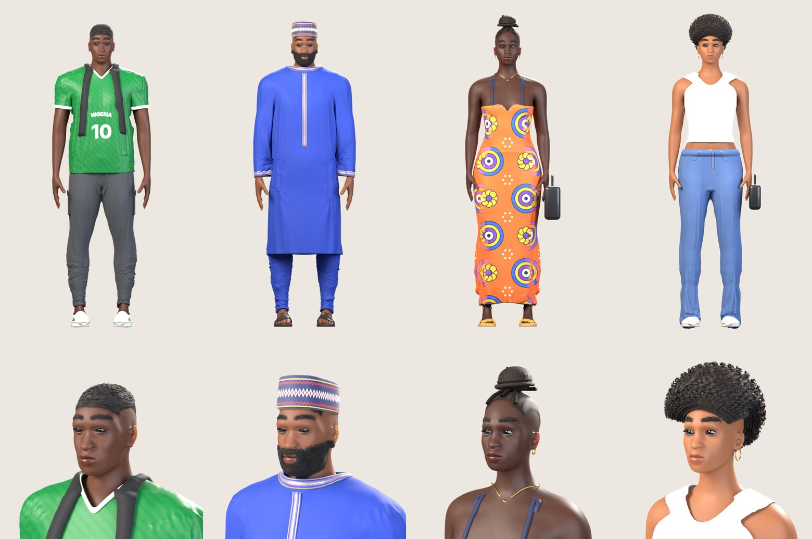

Front, three-quarter, side and back:

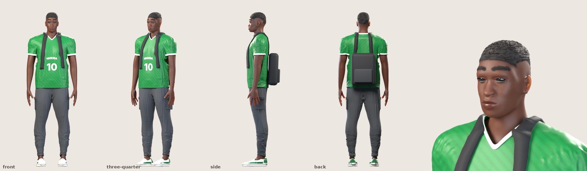
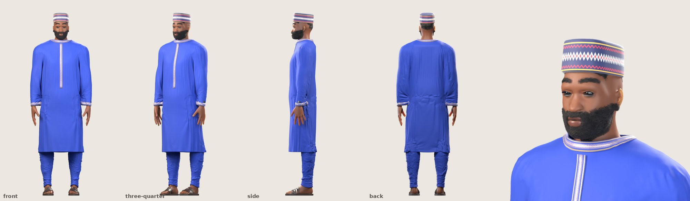
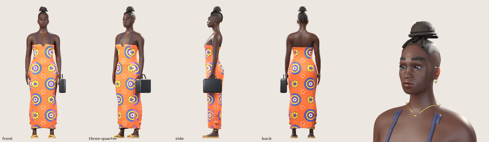
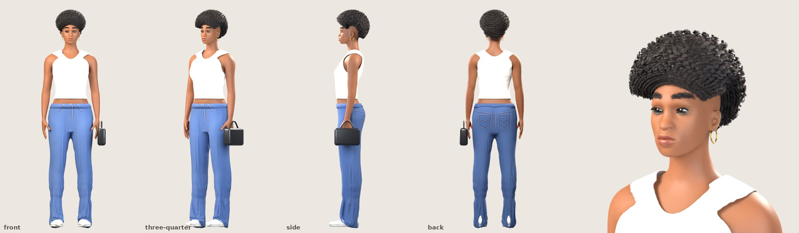

| | Skin, body | Hair | Outfit |
| --- | --- | --- | --- |
| Tunde | deep brown, athletic | low fade | Nigeria 10 jersey, cargo joggers with side pockets and knee seams, white/green trainers, backpack |
| Femi | medium brown, heavier | short beard; patterned fila | royal-blue senator kaftan with embroidery, sokoto, leather slides, watch |
| Amaka | very deep brown | braids in a coiled high bun | ankara maxi dress, gold sandals, handbag, necklace, hoops |
| Zainab | light brown, tall | big afro | white crop tank, wide-leg stitched jeans, white trainers, handbag, hoops |

## 2. Walk and idle in 8 directions

Each sheet has one row per direction (S, SW, W, NW, N, NE, E, SE). Walk frames 0–7 sit left of the grey line and
idle frames 0–3 to the right. They are drawn **from the packed HD atlas** exactly as the game reconstructs them, at 3×. The red
line is the anchor row and the red tick is the anchor pixel: the feet land on it in every direction.

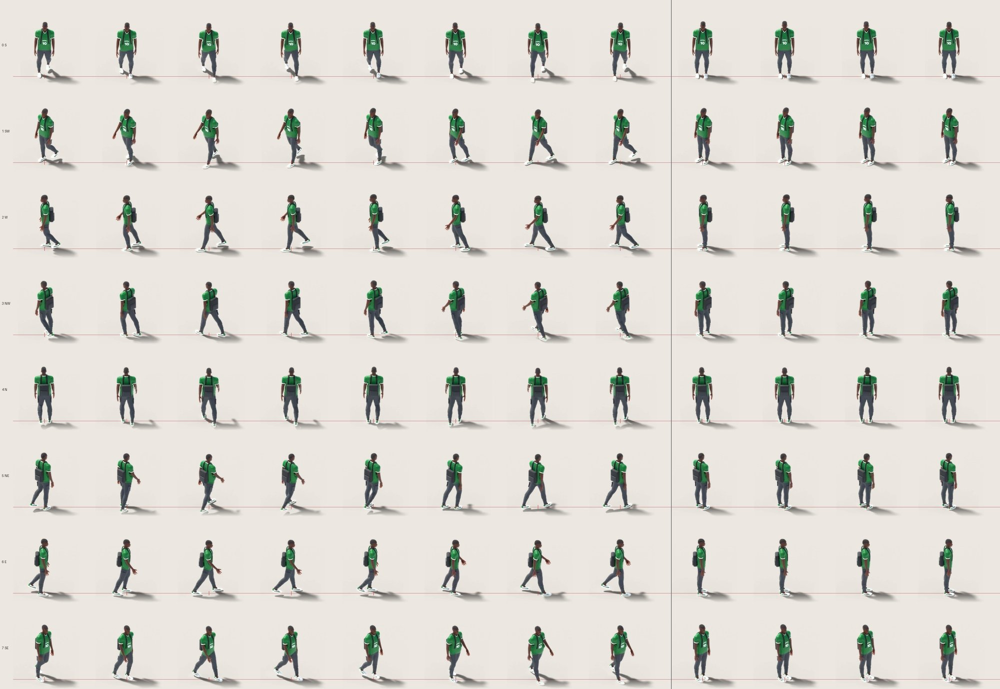
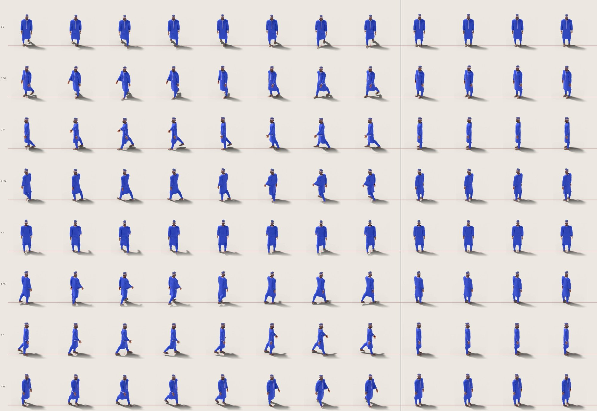
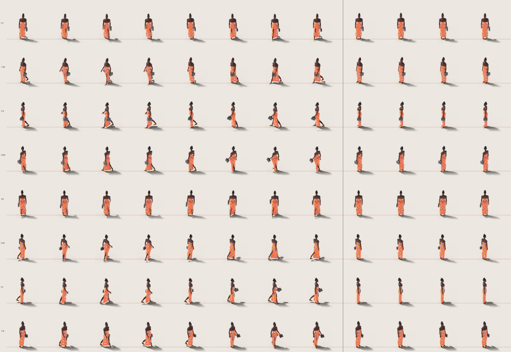
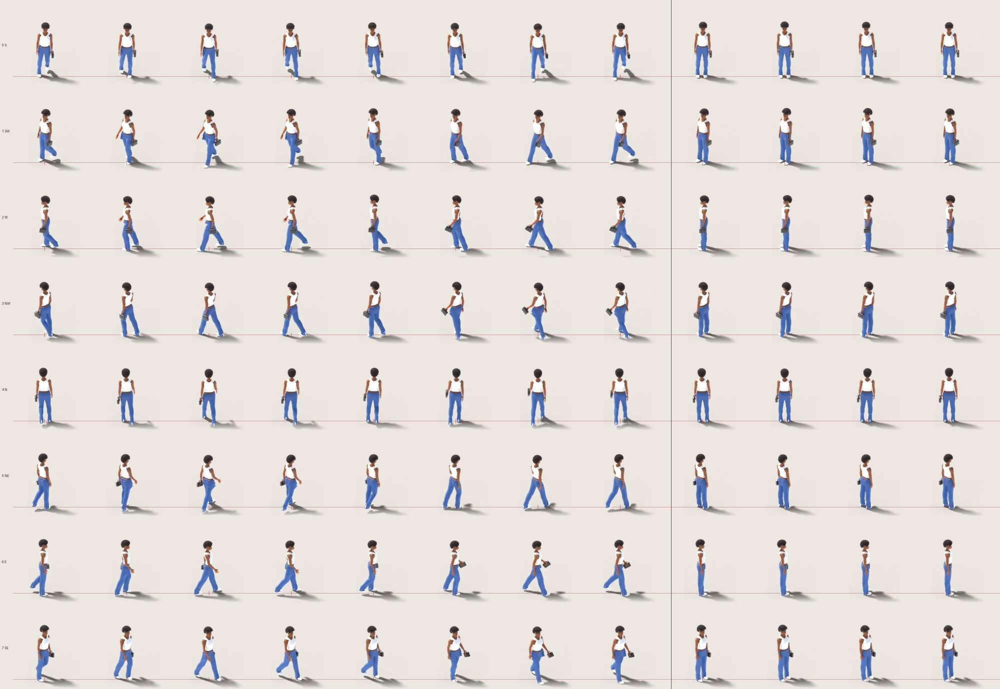

Animated, all 8 directions side by side: [Tunde](character-prototype/m1/walk8-tunde.gif) ·
[Femi](character-prototype/m1/walk8-femi.gif) · [Amaka](character-prototype/m1/walk8-amaka.gif) ·
[Zainab](character-prototype/m1/walk8-zainab.gif)

### Direction changes without jumps (measured)

`sprites.py` now orbits the camera around the **point between the feet** in the rest pose, instead of the world
origin. Iteration 2 was 5.5 cm off, which moved the character up to 1.8 px from its anchor and 3.7 px between opposite
directions. While rendering it records where the pivot, pelvis and top of the head land in every frame.
`check_anchors.py` checks those positions:

| Atlas | Pivot error | Scale spread (head height, opposite pairs) | Largest pelvis shift on a turn | Result |
| --- | --- | --- | --- | --- |
| tunde | 0.000 px | 0.00 px | 1.14 px | OK |
| femi | 0.000 px | 0.00 px | 1.08 px | OK |
| amaka | 0.000 px | 0.00 px | 1.04 px | OK |
| zainab | 0.000 px | 0.00 px | 1.12 px | OK |
| body-tunde, outfit-tunde.tunde, outfit-femi.tunde | 0.000 px | 0.00 px | 1.14 px | OK |

The remaining ≈1 px pelvis shift is the body genuinely rotating 45° around the feet, not drift. Limits are 0.05 px, 1 px
and 3 px. The atlas packer trims each frame but keeps `spriteSourceSize`/`sourceSize`, so trimming never moves a frame.

## 3. In the game: Kuto Street

The existing map, buildings and Phaser depth sorting are unchanged. Characters pass behind and in front of
buildings, posts and each other as before.

The four characters and the three layered looks walking together (desktop, 1200×700 at DPR 2, camera 2×):

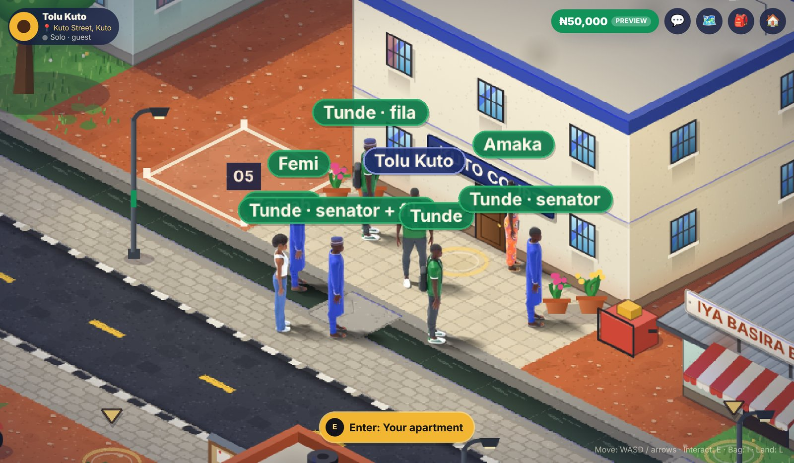

The same at normal zoom, mid-walk (1366×768):

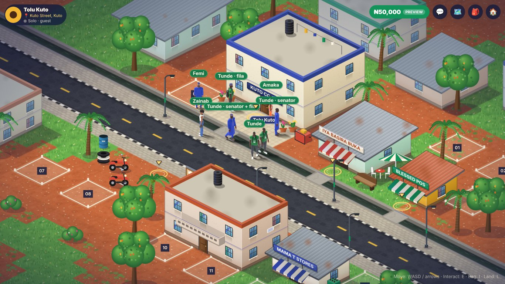

Phone viewport (390×844, DPR 2, normal zoom), HD vs low-memory:

| HD | Low-memory (SD) |
| --- | --- |
| 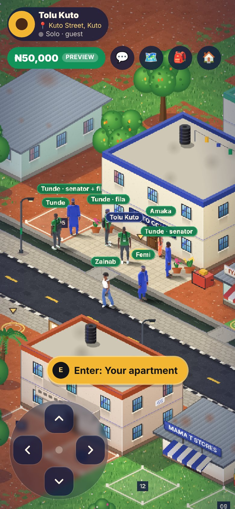 | 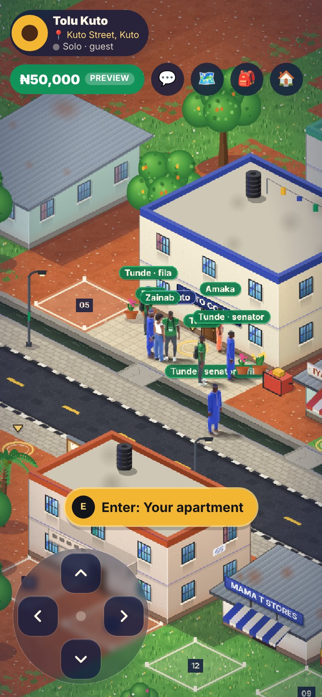 |

Stress test, 21 characters on a simulated 2 GB phone (SD atlases selected automatically):

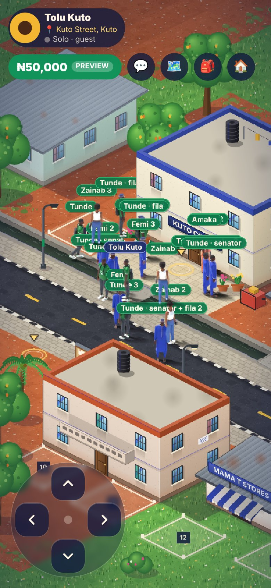

## 4. Before / after at the same in-game size

Rows 1–2 are iteration 2 and rows 3–4 are milestone 1. Each is shown at 1 device px per world px (desktop) and 2 device px per world px (phone,
DPR 2), on the street's ground colour and scaled up with nearest-neighbour so the pixels are visible:

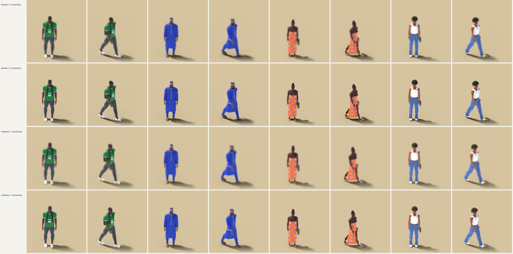

What changed at this size:

- **Trainers.** They have a green heel tab and side stripe, so Tunde's trainers read as designed shoes.
- **Lighting and separation.** The rim light separates the dark jersey, cargo and skin from the shadow.
- **Hems.** Femi's sokoto hem sits at the ankle.
- **Jeans.** Zainab's wide-leg jeans now break on the shoe and show their seams.
- **Hair.** Amaka's bun reads as a bun.
- **Painted baseline.** Today's look, at the same camera, is in [`kuto-group-painted.jpg`](character-prototype/m1/kuto-group-painted.jpg).

## 5. HD vs low-memory

Each frame is drawn at 2 device px per world px (a DPR 2 phone at normal zoom) with bilinear filtering, as WebGL does, then
magnified 3× for inspection:

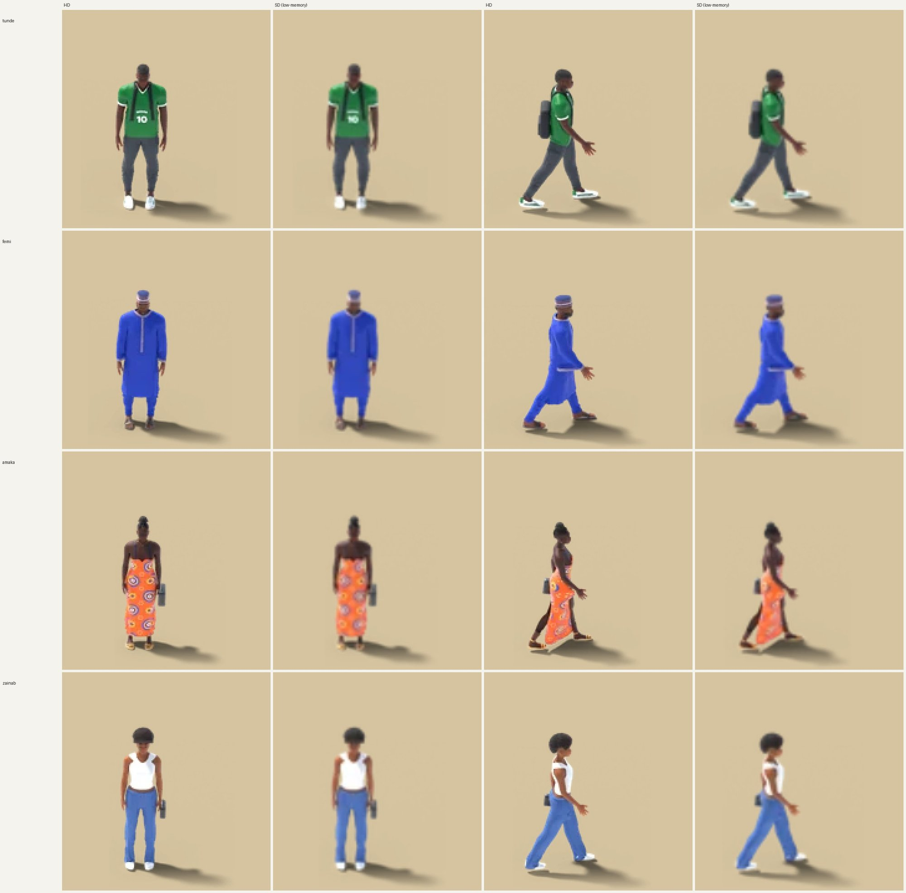

The low-memory atlas is softer, especially on the jersey lettering, the embroidery and the ankara print. Silhouette,
colours, outfit identity and footwear stay clear. In the phone screenshot above at true size the difference is hard
to see. **Assessment: acceptable for low-memory phones** (to be confirmed on a real device).

## 6. Customisation: layered body, outfit and hair

`sprites.py` can render the same character as separate layers:

- **body:** skin and face, with the clothes as a holdout;
- **outfit:** garments, shoes and accessories, with the body as a holdout;
- **hair:** hair and headwear, with body and clothes as holdouts.

All layers share the skeleton, cameras and anchors, so the game stacks them (body → outfit → hair) on the same
frame. **Stacking body + jersey + fade reproduces the baked Tunde render: mean difference 0.43/255 over 96 frames,
1.25% of pixels differ by more than 16/255, all at anti-aliased edges.**

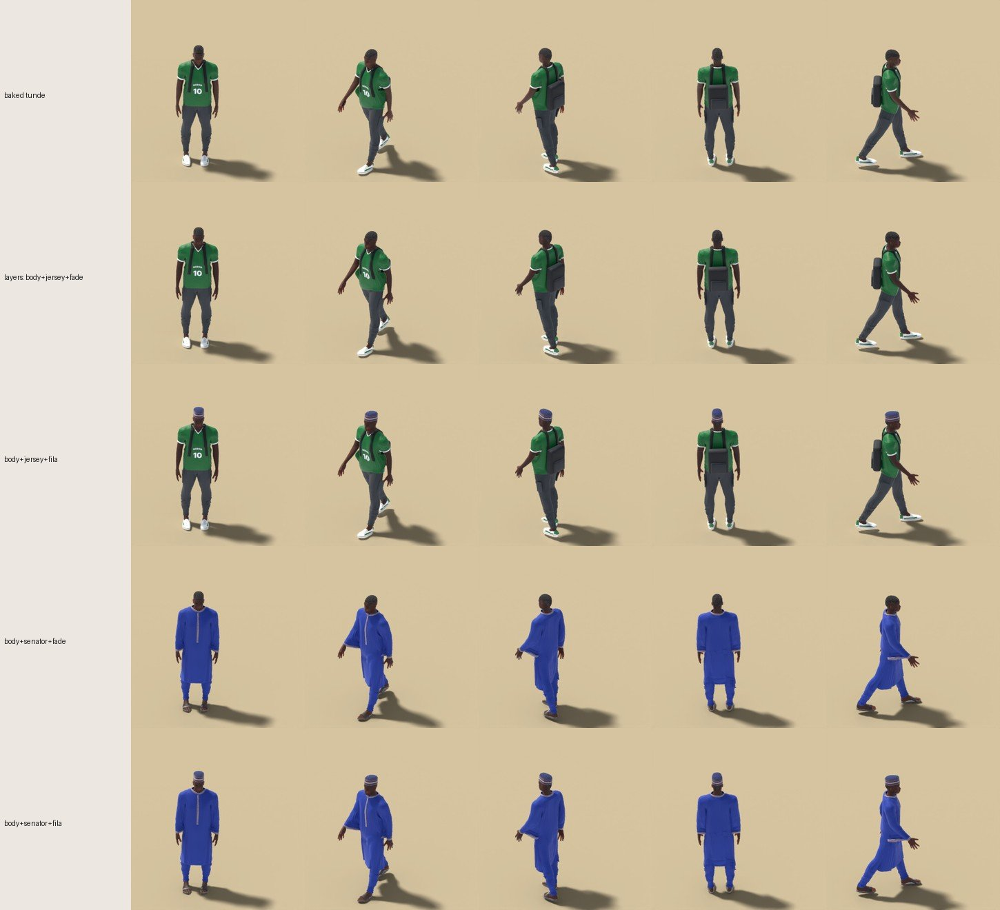

Row 1 is baked. Rows 2–5 are stacked layers: jersey or senator outfit, fade or fila. The senator outfit and the fila are
Femi's garment designs, re-fitted and draped on Tunde's body (`sprites.py -- tunde femi fade`).

Atlases this needs:

| Way to get 4 looks for one body | Atlases | HD download | HD GPU memory |
| --- | --- | --- | --- |
| baked, one full atlas per combination | 4 | ≈ 4 × 490 KB | ≈ 4 × 7 MB |
| layered: 1 body + 2 outfits + 2 hair | 5 | 1.25 MB | 16.3 MB |

The atlases needed grow with the **sum** of options, not the **product**. Outfits are fitted per body shape, so for B body
shapes, O outfits and H hairstyles the count is about B × (1 + O + H) atlases, not B × O × H. A player only downloads
the layers they see.

The cost of layering:

- **Draws.** A layered character draws 3 sprites instead of 1. These are the same texture-atlas draws that Phaser batches.
- **Memory.** One layered look alone uses about 30% more memory than its baked atlas (9.5 MB vs 7.3 MB HD), because
  layers overlap. Sharing pays back once a body is used with two or more looks.

Known limitation: the body layer is rendered with skin masked under the outfit used to render it. That is the
jersey here, which is why the longer senator kaftan works. An outfit that shows more skin than the masking outfit
would expose holes. The fix for production is to render the body layer with a minimal mask (underwear coverage) once
per body. That is the plan in section 9. The existing painted avatar options, the avatar picker and the save format
are unchanged.

## 7. Atlases

WebP, quality 88 (alpha 90), frames trimmed and shelf-packed into ≤ 2048 px wide sheets:

| Atlas | HD size | HD file | HD GPU | SD size | SD file | SD GPU |
| --- | --- | --- | --- | --- | --- | --- |
| tunde | 2041×939 | 508 KB | 7.3 MB | 2033×343 | 249 KB | 2.7 MB |
| femi | 2048×784 | 452 KB | 6.1 MB | 2041×333 | 223 KB | 2.6 MB |
| amaka | 2039×620 | 435 KB | 4.8 MB | 2021×239 | 208 KB | 1.8 MB |
| zainab | 1984×796 | 478 KB | 6.0 MB | 2022×340 | 239 KB | 2.6 MB |
| body-tunde | 2011×363 | 285 KB | 2.8 MB | 2048×156 | 160 KB | 1.2 MB |
| outfit-tunde.tunde | 2039×849 | 475 KB | 6.6 MB | 2032×310 | 228 KB | 2.4 MB |
| outfit-femi.tunde | 2034×848 | 439 KB | 6.6 MB | 2030×309 | 211 KB | 2.4 MB |
| hair-fade.tunde | 1765×18 | 20 KB | 0.1 MB | 1345×13 | 13 KB | 0.1 MB |
| hair-fila.tunde | 1916×22 | 29 KB | 0.2 MB | 1512×15 | 19 KB | 0.1 MB |

The four baked characters total 24.3 MB of GPU memory in HD (iteration 2: 27.1 MB) and 9.7 MB in SD (iteration 2: 11.7 MB).

I tested lower WebP quality on Tunde: q82 saves 7% (510 → 476 KB HD) at a mean change of 2.8/255 on character
pixels; q76 saves 12% at 3.5/255. GPU memory does not change with file quality, so I kept q88. Per-atlas
quality can be lowered later if download size matters more than print detail.

## 8. Measurements in the game (browser simulation, not a phone)

The harness opens `/play` as a guest in a lab build:

1. It waits for the world, then for every character to be drawn from its atlases.
2. It measures frame rate and main-thread time per frame for 5.6 s while the player walks a square.
3. It counts texture memory and records every atlas download.

| Run | `deviceMemory` | Atlases picked | Characters | World ready | All characters drawn | FPS* | Main thread / frame (median, p95) | Texture memory (all / characters) | Atlas download |
| --- | --- | --- | --- | --- | --- | --- | --- | --- | --- |
| desktop, painted (today) | – | – | 5 | 1151 ms | 1673 ms | 12.9 | 3.2 / 5.1 ms | 15.7 / 0 MB | 0 |
| desktop, 3D | 8 | HD | 5 | 956 ms | 1938 ms | 13.9 | 2.8 / 4.5 ms | 38.9 / 24.3 MB | 1876 KB |
| desktop, 3D, `labq=sd` | 8 | SD (forced) | 5 | 1011 ms | 1902 ms | 13.7 | 3.2 / 4.5 ms | 24.3 / 9.7 MB | 921 KB |
| desktop, 3D + layered looks | 8 | HD | 8 | 990 ms | 2741 ms | 11.8 | 4.5 / 6.4 ms | 55.1 / 40.5 MB | 3126 KB |
| phone, painted (today) | – | – | 5 | 1246 ms | 1572 ms | 27 | 3.1 / 4.6 ms | 22.8 / 0 MB | 0 |
| phone, 3D | 8 | **HD** | 5 | 1208 ms | 1970 ms | 28 | 3.1 / 5.0 ms | 46.1 / 24.3 MB | 1876 KB |
| phone, 3D | 2 | **SD** | 5 | 1214 ms | 2022 ms | 30 | 2.9 / 4.2 ms | 31.5 / 9.7 MB | 921 KB |
| phone, 21 painted (today) | – | – | 21 | 1094 ms | 1549 ms | 18.2 | 8.9 / 13.1 ms | 22.8 / 0 MB | 0 |
| phone, 21 3D + layered | 2 | **SD** | 21 | 1061 ms | 2069 ms | 19.5 | 8.2 / 10.8 ms | 37.7 / 15.9 MB | 1555 KB |
| phone, 21 3D + layered | 8 | **HD** | 21 | 1131 ms | 2490 ms | 19.4 | 8.5 / 12.0 ms | 62.3 / 40.5 MB | 3126 KB |

\* Software WebGL on CPU, so not comparable to a phone GPU. In every pair, painted and 3D run at the same rate.

What this shows:

- **Memory selection works.** `deviceMemory` 8 picks HD and 2 picks SD, and `?labq` overrides it. Every run downloaded only one
  quality, and no run reported page errors.
- **Loading is on demand and does not block the world.** The world is ready in about 1 s with or without 3D characters.
  The local player's atlas is requested first, at about 1.5 s. Other characters' atlases follow when their walkers appear, and atlases
  shared by several looks (`body-tunde`, `hair-fade.tunde`) download once. Until its atlas arrives, a character shows a
  placeholder shadow and name tag, and then switches over.
- **Frame cost is unchanged.** Main-thread time per frame is the same as the painted characters with 5 and with 21
  characters. Sprites are textured quads either way.
- **Memory** is the real cost: +24 MB (HD) or +10 MB (SD) for the four baked characters, and +40 MB / +16 MB with all nine
  atlases. This is why SD exists and why layers load on demand.

### Not tested

- **Real Android devices.** Real phones may differ in GPU upload time for large textures, thermal throttling, WebView
  memory limits and real network latency. These are the next things to measure (section 9).
- **Slow networks.** Downloads were from localhost. On 3G, about 1–2 MB of HD atlases is several seconds. The world does not wait
  for it, but characters would show placeholders for that long.

## 9. Proposed next steps (for approval)

1. **Real-device test**, before any production work:
   - a low-end Android phone (2–3 GB) and a mid-range one (4–6 GB);
   - load time on 4G and 3G, frame time with 5 and 20 characters, and memory in Chrome remote debugging;
   - confirm that SD looks acceptable at true size.
2. **Body layer with a minimal mask**, so any outfit works on any body (section 6).
3. **Character configurations** `{ body, outfit, hair }`:
   - each maps to layer atlases;
   - saved alongside today's `AvatarSelection`;
   - existing painted options stay as a fallback.
   - This needs a design for the save format, and a migration only if it is stored server-side. Not started; needs approval.
4. **Atlas budget per scene.** Unload atlases for characters no longer on screen, and cap HD to the N nearest characters on
   low-memory phones.
5. **Pipeline throughput.** A full character takes 4–19 min on 4 CPU cores and a layer set about 26 min. A GPU render machine
   would cut this by about 10×.

## How to reproduce

See `docs/character-prototype.md` § 9. Milestone 1 additions:

```sh
LAYERS=body,outfit,hair python sprites.py -- tunde            # layered: body-tunde, outfit-tunde.tunde, hair-fade.tunde
LAYERS=outfit python sprites.py -- tunde femi fade            # Femi's outfit fitted on Tunde -> outfit-femi.tunde
LAYERS=hair python sprites.py -- tunde tunde fila             # hair-fila.tunde
python3 check_anchors.py $OUT_DIR/*-anchors.json              # pivot / scale / turn checks
NEXT_PUBLIC_CHARACTER_LAB=1 npm run build && npm start
# /play?lab=characters  ·  &labq=sd|hd  ·  &labmix=1 (layered looks)  ·  &labn=20 (stress)  ·  /play?lab=painted
```
