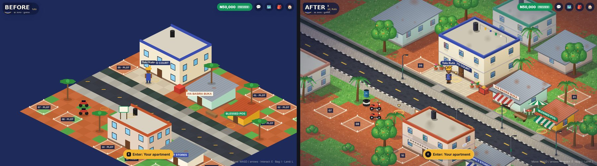

# Visual pass: art direction, asset inventory and measurements

The visual pass turns the Kuto street prototype into a coherent, warm 2D cartoon neighbourhood. It keeps the existing
Phaser architecture, isometric projection, map data, collision, interactions, multiplayer, land and economy code.

## 1. Audit: what limited the look (before)

| Area | Weakness |
|---|---|
| World edge | The 20 × 18 map floated in a navy void, so it read as a test board rather than a neighbourhood. |
| Ground | Flat two-tone checkerboard tiles with no texture. Grass appeared as scattered single tiles. There was no kerb, drain detail or lane paint beyond a few dashes. |
| Buildings | Flat-shaded boxes without outlines or texture. Windows were pasted-on squares. Flat roofs were large empty planes. Signs were floating text labels that the player's name tag often covered. |
| Props | Palms looked like lollipops, the okadas didn't read as motorcycles, the generator was a red cube, and the notice board was a white rectangle. |
| Characters | Characters were about 76 px tall against 34 px doors (out of scale). Legs were two rectangles, with no idle animation and no outline. |
| Lighting and depth | No shadows, no light direction, no atmosphere. |
| Draw order | `depth = x + y` drew props behind a building on top of it: the notice board and lamps appeared on the two-storey roof. |
| Readability | Twelve dark "NN · PLOT" tags were always on, cluttering the street. |
| Phones | The canvas rendered at 1× and was blurry on 2–3× screens. The interaction prompt overlapped the D-pad. The D-pad was a set of plain square boxes. |
| Performance | About 400 Graphics paths were re-tessellated on the CPU every frame. |

The live production site could not be opened from the build sandbox, because its proxy refuses it. Production runs
`main` at `e919e77`, so the "before" screenshots come from a local guest-mode build of that exact commit. Nothing
in production was touched.

## 2. Art direction

- **Style:** premium 2D cartoon in the existing 2:1 isometric projection. Shapes have soft dark outlines, colour is
  painterly, and detail is readable at phone size.
- **Light:** warm late afternoon from the upper left. Left-facing walls are lit and right-facing walls are in shade.
  Soft shadows fall to the lower right.
- **Palette:** one shared palette (`src/game/art/palette.ts`) built on the brand colours (Ogun green, adire indigo,
  laterite, palm gold, cream) and the red earth of Abeokuta streets.
- **Place:** everyday Nigerian urban details:
  - Ground and street: laterite dust splashed up walls, black-and-white kerbs, an open drain with slab crossings.
  - Walls and windows: burglar-proof bars, rain streaks under sills, breeze-block balconies.
  - Roofs: black rooftop water tanks, rusting corrugated zinc, a washing line on the roof.
  - Street life: plastic chairs outside the buka, a street-vendor umbrella, okadas, a refuse drum.
  - People: ankara prints, fila, gele, braids.
- **No brands:** shop names are the game's own; no real company names or logos appear.

## 3. Asset inventory

Every asset is **original and painted from code** in this repository at load time (Canvas 2D → texture). No image
file, font file, sprite sheet or third-party artwork is downloaded or bundled, so there is nothing to license. Text
on signs uses the device's system fonts ("Trebuchet MS", "Segoe UI", Verdana). Painting is deterministic (seeded),
so every player sees the same world.

| Asset set | What | Painted by | Replaces |
|---|---|---|---|
| Ground atlas (21 tile variants) | Laterite (4), grass (3), grass edge (2), road, road edges and lane dashes (5), pavers and kerbs (3), drain, drain slab, courtyard (2) | `art/groundArt.ts` | `TILE_COLORS` flat fills |
| Ground layout | Which variant goes where, grass patches, the street continuing past the map, dimmed outskirts | `art/groundLayout.ts` (tested) | `tileAt` colour lookup |
| Buildings (5 + 6 distant) | Walls, windows, doors, shop fronts, kiosk hatch, awnings, balconies, parapets, tanks, zinc roofs, signboards, washing line, AC unit | `art/buildingArt.ts` | `render/buildings.ts` (deleted) |
| Building shadows | Soft ground shadows, painted into the ground | `art/buildingArt.ts` | none |
| Props (14 kinds) | Palm, mango tree, bush, okada, generator, notice board, bench, lamp post, plastic chairs, umbrella stall, refuse drum, flower pots, tyres, drink crates | `art/propArt.ts` | Graphics props |
| Characters | Per-avatar sprite sheet: 4-frame walk, 2-frame idle; every body × skin × headwear × outfit combination | `art/avatarArt.ts`, `entities/PlayerAvatar.ts` | Graphics avatar |
| Name tags, plot tags, markers | Rounded pills, compact plot tags that expand when you are close, glowing ring with a bobbing chevron | `scenes/StarterAreaScene.ts`, `entities/PlayerAvatar.ts` | text labels, plain ellipse |
| Street decor (data) | 15 placements: lamps, chairs, umbrella, pots, drum, tyres, crates, trees | `world/starterArea.ts` `DECOR` (tested) | none |
| Distant scenery (data) | 6 buildings beyond the north and west edges, plus trees, palms and bushes in the outskirts | `world/scenery.ts` (tested) | none |
| Touch controls, prompt, vignette | Translucent rounded D-pad with chevrons; prompt above the D-pad on touch screens; CSS vignette | `components/game/TouchControls.tsx`, `InteractionUi.tsx`, `GameCanvas.tsx` | square D-pad |

## 4. What changed technically, and what did not

- **Painted once, drawn as quads.**
  - Every texture is painted at load into a scratch canvas, trimmed to its visible pixels and uploaded.
  - The ground uses a Blitter. Phaser's Blitter ignores its own scale, so the ground is scaled through the
    DynamicTexture camera instead.
  - The ground and the building shadows are then painted into a few chunk textures, at most 1024 px a side, that
    cover exactly what the camera can show. At run time each screen pixel of ground is drawn once.
- **Depth sort** (`iso/depthSort.ts`): a topological order for buildings and props, plus a per-frame slot for each
  character. This fixes props behind a building drawing on top of it.
- **HiDPI:** the canvas renders at the device pixel ratio. It is capped at 2, and at 1.5 when the phone reports four
  or fewer CPU cores or 3 GB or less of memory. The CSS size is unchanged.
- **Scale:** characters are now about 46 px tall, so the 30 px doors fit them. Building geometry (`h`) is unchanged,
  because the land-placement tests use it.
- **Unchanged:**
  - movement speed and collision radius;
  - map data, buildings, props and interaction spots;
  - the multiplayer protocol, remote smoothing, bubbles and emotes;
  - land plots and the purchase flow;
  - all HTML panels, the HUD and `GameScreen.tsx`. The jobs/shops branch edits these, so this pass doesn't.
- **One deliberate gameplay change:** the 15 decor items are solid, like palms. Tests check that none sits on a plot,
  door approach, interaction spot, the road or the spawn. They also flood-fill the map to confirm that every plot
  tile, door and interaction spot, and the whole road, is still reachable on foot.

## 5. Measurements (local build, guest mode, headless Chromium)

| | Before (`main`) | After |
|---|---|---|
| Main-thread time per frame, desktop 1366×768 (median / p95) | 2.5 / 3.8 ms | 1.3 / 2.3–2.7 ms |
| Main-thread time per frame, phone 390×844 @2× (median / p95) | 2.1 / 3.2 ms | 0.9–1.3 / 2.0–2.3 ms |
| Time to first world frame (painting the textures) | 0.54–0.67 s | 0.84–1.14 s |
| Textured quads on screen / quad area ÷ screen area | n/a (Graphics) | 30–49 quads / about 1.8× |
| Texture memory (painted) | about 0 | 14.9 MB desktop (1×), 22 MB phone (1.5×) |
| Canvas resolution on a 2× phone | 1× (blurry) | 1.5–2× (sharp) |

Notes:

- **Main-thread time:** measured from the game's `prestep` to `postrender` while walking. It is the JavaScript
  update plus building the draw commands, which costs battery and frames on phone CPUs.
- **Sandbox frame rate:** the sandbox has no GPU, so Chromium rasterises in software (SwiftShader). There the frame
  rate is limited by pixels filled: about 17 fps after versus 22 before on desktop, and 36 versus 47 on phone. The
  "before" version left most of the screen as empty background; the "after" version fills it with ground. Real phone
  GPUs fill these few full-screen quads cheaply, but **this must be confirmed on real mid- and low-end Android
  phones** (see section 7).
- **Startup:** painting adds roughly 0.3–0.5 s before the first frame on this machine. That will be slower on
  low-end phones.

## 6. Tests

- `npm test`:
  - 121/121, up from 104;
  - new tests cover colours, the ground layout, the depth sort, render scale, and decor placement and reachability;
  - the existing land map tests still pass.
- `npm run typecheck`, `npm run build`: pass. `/play` first-load JS is 196 kB, up from 195 kB. The painters live in the game chunk, which loads only on `/play`.
- `npm run test:api`: 14/14.
- Browser checks at 1366×768 and 390×844 @2×:
  - walking, the interaction prompt, the inventory panel, plot tags and markers;
  - three remote players joining, a chat bubble with Yoruba diacritics, the player's own bubble, and a wave emote;
  - no page errors, console errors or failed requests.

## 7. Remaining visual improvements (next phases)

1. **Real-device profiling:** measure frame rate, startup and memory on a mid-range and a low-end Android phone.
   If startup is slow, paint lazily or cache the painted textures (for example ImageBitmap in IndexedDB).
2. **Bubbles and name tags** from people standing together overlap. Stack them, or fade the ones further away.
3. **The apartment interior** (`/apartment`) still uses the old flat style; it needs a painted interior.
4. **Character facing:** add back-facing frames when walking up the screen. This needs one more field in the
   multiplayer state to keep remote players consistent.
5. **Ambient life:** smoke from the buka, an occasional passing okada or bird, and a day/evening tint (with street
   lamps glowing).
6. **HUD and panels:** a shared icon set instead of emoji, and consistent panel headers. Left alone for now, because
   the jobs/shops branch edits `Hud.tsx` and `GameScreen.tsx`.
7. **Construction and furniture art,** built on the same painters and palette, for the later house and interior
   phases.
